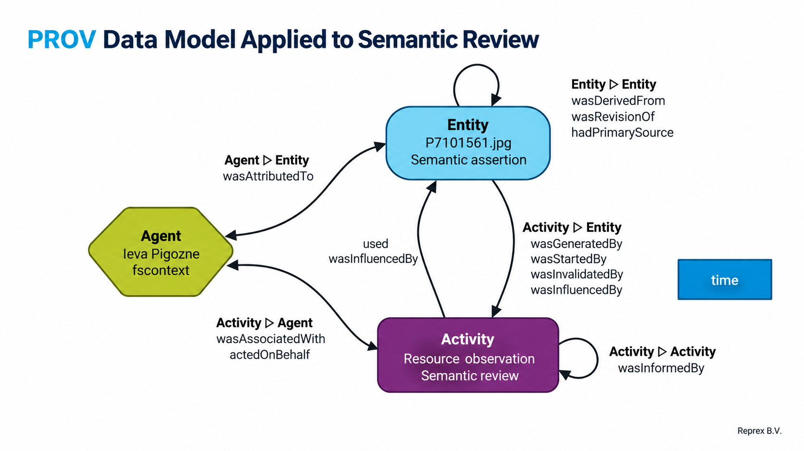
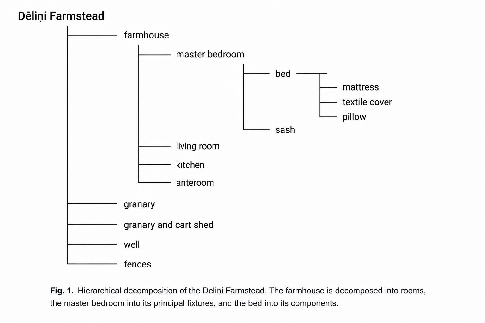

# FinFAIR: Reprex applications

## Introduction

Heritage Digital Twins require more than semantic descriptions of cultural heritage objects. They must support the continuing production, review, maintenance and governance of knowledge derived from heterogeneous documentary evidence. In practice, this knowledge is maintained across institutional databases, knowledge graphs, archival systems and research workflows that cannot reasonably be expected to adopt a single ontology or software environment.

The [Finno-Ugric Data Sharing Space (FUDSS)](https://finnougric.net/) addresses this challenge through an operational architecture combining Wikibase for collaborative knowledge maintenance, Betwixt for provenance-aware knowledge production and review, Apache Jena Fuseki for semantic querying, and Sampo-UI for exploration. Rather than replacing these applications with an HDT-O-specific repository, we propose projecting their maintained knowledge into ontology-aligned representations suitable for exchange with ECHOES.

Our contribution is threefold. First, we demonstrate how existing Wikibase resources can be represented as Heritage Digital Twins (`HC2`) while preserving the distinction between the twins and their represented heritage entities (`HC1`). Second, we propose a workflow connecting reviewed propositions and their provenance to persistent Heritage Proposition Sets (`HC16`). Third, we investigate how documentary works and their digital representations can be independently identified and governed, particularly when rights and permitted uses differ across representations.

Using the **Dēliņi farmhouse and its photographic documentation** as a worked example, this paper presents reproducible RDF representations and identifies both proposed solutions and unresolved questions concerning HDT-O modelling, persistence, provenance and interoperability. Its purpose is to establish a concrete basis for technical discussion, validation and potential collaborative development with ECHOES, rather than to claim conformance with an exchange specification that has not yet been fully established.

The **Finno-Ugric Data Sharing Space (FUDSS)** is a governed cultural heritage data sharing environment built around four complementary applications. Each supports a different aspect of creating, maintaining, reviewing, querying, and sharing knowledge about Heritage Digital Twins[^1].

[^1]: See *Federating Open Knowledge through Wikibase: The Case of The Finno-Ugric Data Sharing Space* [@fudss_2026]

### MediaWiki and Wikibase

We use **MediaWiki and Wikibase** as a collaborative, user-friendly knowledge management environment. Wikibase stores structured statements in a relational database (MariaDB or MySQL) and exposes them as a document-oriented knowledge graph through RDF and SPARQL interfaces.

Wikibase is the software underlying Wikidata, one of the world's largest collaboratively maintained knowledge graphs. Its familiar item-and-property model allows researchers and curators to maintain semantic data without requiring detailed knowledge of RDF or ontology engineering.

Our Wikibase implementation supports bounded federation with Wikidata, Wikimedia Commons, and Wikipedia, allowing locally governed knowledge to be connected to external authority records, media resources, and encyclopaedic descriptions.

### Sampo-UI

**Sampo-UI** is a semantic browsing framework developed at Aalto University and the University of Helsinki. It provides an established approach to exploring humanities knowledge graphs through dynamic faceted search, filtering, and visualisation.

In our implementation, Sampo-UI allows users to query and investigate multimodal heritage knowledge through intuitive interfaces, including tabular views and other projections of the underlying graph.

### Apache Jena Fuseki

**Apache Jena Fuseki** provides our SPARQL query service and API access to the semantic knowledge graph.

It serves as the query backend for our Sampo-UI application and enables authorised users and applications to access the graph programmatically through SPARQL endpoints.

### Betwixt

**Betwixt** is an intermediate representation framework and supporting reference application under development by Reprex. It facilitates the transformation, review, and exchange of semantic knowledge across different data structures, including knowledge graphs, relational databases, spreadsheets, tabular datasets, matrices, tensors, and vector representations.

Betwixt supports bounded federation between independently governed datasets and enables researchers and curators to work with graph-based knowledge without directly manipulating RDF.

For example, users can review, correct, or contribute candidate statements through familiar Excel spreadsheets or tabular HTML interfaces. These changes can be accompanied by provenance and review information before accepted propositions are incorporated into the knowledge graph.

### Finno-Ugric Data Sharing Space

Together, these four applications provide the operational environment of the **Finno-Ugric Data Sharing Space**.

Wikibase supports collaborative knowledge maintenance; Sampo-UI supports exploration and investigation; Fuseki provides semantic query and API services; and Betwixt supports cross-format knowledge exchange, curatorial review, and governed contributions.

**These applications are not themselves the Heritage Digital Twins or the underlying datasets.** They are complementary interfaces and services through which users interact with the knowledge maintained in the data sharing space. Our operational data model is designed to work effectively across these applications while supporting projection into ontology-aligned exchange representations, including HDT-O and CIDOC CRM.

In this document, we refer to a few digital twins developed in the *Finno-Ugric Data Sharing Space*.

The [Dēliņi farmhouse (Q7328)](https://reprexbase.eu/fu/Item:Q7328) is part of the [Dēliņi farmstead (Q5582)](https://reprexbase.eu/fu/Item:Q5582). Two historical photographs, [frontal view with well (Q7362)](https://reprexbase.eu/fu/Item:Q7362) and [oblique view (Q7363)](https://reprexbase.eu/fu/Item:Q7363), depict the farmhouse. Each photograph may have its own digital twin (`HC2`), while its digital image may also serve as a digital representation (`HC5`) of the farmhouse.

```{mermaid}


%%{init: {"theme": "base", "themeVariables": {
  "background": "#ffffff",
  "primaryTextColor": "#263238",
  "lineColor": "#64748b",
  "edgeLabelBackground": "#ffffff",
  "clusterBkg": "#f8fafc",
  "clusterBorder": "#cbd5e1"
}}}%%

flowchart TB
    subgraph P["Heritage objects"]
        direction LR
        FS["Dēliņi farmstead"]
        FH["Dēliņi farmhouse"]
        PH1["Frontal photograph"]
        PH2["Oblique photograph"]
        FH -->|part of| FS
        PH1 -->|depicts| FH
        PH2 -->|depicts| FH
    end

    subgraph T["Heritage Digital Twins · HC2"]
        direction LR
        TFS["Farmstead · Q5582"]
        TFH["Farmhouse · Q7328"]
        TP1["Photograph · Q7362"]
        TP2["Photograph · Q7363"]
    end

    subgraph R["Digital representations · HC5"]
        direction LR
        R1["Frontal digital image"]
        R2["Oblique digital image"]
    end

    FS -.-> TFS
    FH -.-> TFH
    PH1 -.-> TP1
    PH2 -.-> TP2

    PH1 -.-> R1
    PH2 -.-> R2
    R1 -->|represents| FH
    R2 -->|represents| FH

    classDef physical fill:#f1f5f9,stroke:#64748b,color:#1e293b
    classDef twin fill:#dbeafe,stroke:#2563eb,color:#1e3a8a
    classDef representation fill:#dcfce7,stroke:#16a34a,color:#14532d

    class FS,FH,PH1,PH2 physical
    class TFS,TFH,TP1,TP2 twin
    class R1,R2 representation

    style P fill:#f8fafc,stroke:#94a3b8,color:#334155
    style T fill:#eff6ff,stroke:#93c5fd,color:#1e40af
    style R fill:#f0fdf4,stroke:#86efac,color:#166534

```

## Wikibase and Betwixt as operational semantic layers

Our applications use formal semantic models that serve a different purpose from domain ontologies such as HDT-O, CIDOC CRM, the International Council on Archives Records in Contexts Ontology (RiC-O) and DCTERMS[^2].

[^2]: International Council on Archives Records in Contexts Ontology (ICA RiC-O) version 1.1 [@RiC-O_1_1] and the library standard DCTERMS [@dublin_core_dcmi_2020].

These domain ontologies and vocabularies describe cultural heritage objects, archival records, bibliographic resources, their relationships, and their contexts. By contrast, Wikibase and Betwixt provide *operational semantic structures* that help us maintain, exchange, review, and investigate knowledge expressed using different domain models.

The [Wikibase ontology](https://www.mediawiki.org/wiki/Wikibase/DataModel) describes how knowledge is represented within the Wikibase data model, including items, properties, statements, qualifiers, references, and ranks [@wikibase_datamodel]. It enables us to maintain knowledge from different domains in a common, user-friendly environment while preserving mappings to the original domain ontologies.

The [Betwixt Vocabulary](https://usebetwixt.com/articles/betwixt-vocabulary.html), building on Schema.org and PROV-O, supports the intermediate representation and review of knowledge [@antal_betwixt_2026]. [Schema.org](https://schema.org/) provides a widely adopted vocabulary for structured data, while [PROV-O](https://www.w3.org/TR/prov-o/) expresses the W3C PROV Data Model ([PROV-DM](https://www.w3.org/TR/prov-dm/)) for describing entities, activities, agents and their relationships in the production of information. Betwixt supports the transformation of statements from knowledge graphs, relational databases and other data structures into tabular, matrix, tensor or simpler graph representations. Researchers and curators can inspect, correct and warrant claims through familiar interfaces, such as Excel spreadsheets or HTML tables, before accepted knowledge is published back into a graph.

{fig-align="center"}

The Wikibase ontology and Betwixt Vocabulary therefore support applications for data stewards, researchers and educators who possess expertise in cultural heritage but may lack specialised knowledge of RDF, ontology engineering or data programming. For example, a curator can describe the Dēliņi farmhouse in Wikibase, review candidate statements through Betwixt, investigate the resulting knowledge through Sampo-UI and query it through Apache Jena Fuseki. When interoperability requires an explicit HDT-O and CIDOC CRM representation, documented semantic mappings can produce the corresponding exchange structure.

**Our objective is to separate expertise in cultural heritage from expertise in semantic technologies.** Curators, researchers and community experts should be able to contribute and review knowledge using familiar applications, while the underlying semantic infrastructure supports provenance, governance and interoperability across different cultural heritage domains.

### Semantic projection from Wikibase to HDT-O

Wikibase can represent knowledge expressed in HDT-O and CIDOC CRM using its own item-and-property model (see [@pfeiffer_representing_2021; @kesaniemi_wb_cidoc_202]). Ontology classes can be represented as Wikibase items and ontology properties as Wikibase properties. Class hierarchies can be expressed through *subclass of* relationships, while individual resources can be assigned to classes through *instance of* relationships. Wikibase statements can also carry qualifiers and references. However, representing an ontology within Wikibase and exporting an ontology-aligned RDF graph are distinct operations: the latter requires explicit mappings between Wikibase identifiers and the corresponding ontology classes, properties and relationships.

Our approach distinguishes the *operational representation of heritage knowledge* from its *ontology-aligned exchange representation*. Wikibase allows curators to work with familiar domain-specific classifications, while documented mappings allow us to project selected knowledge into HDT-O and CIDOC CRM[^3].

[^3]: Heritage Digital Twins Ontology [@echoes_hdto_1-1] and the CIDOC Conceptual Reference Model [@cidoc_2024].

In the Finno-Ugric Data Sharing Space, curators generally work with one principal Wikibase item for each Heritage Digital Twin (`HC2`). This item maintains evolving statements about the represented heritage entity, together with links to related resources and supporting evidence. For example, the [Dēliņi farmhouse (Q7328)](https://reprexbase.eu/fu/Item:Q7328) and [Dēliņi farmstead (Q5582)](https://reprexbase.eu/fu/Item:Q5582) are maintained as operational digital twins.

HDT-O distinguishes the Heritage Digital Twin (`HC2`) from the Heritage Entity (`HC1`) that it represents. To demonstrate this distinction, we also created the [physical Dēliņi farmhouse (Q7376)](https://reprexbase.eu/fu/Item:Q7376) and [physical Dēliņi farmstead (Q7379)](https://reprexbase.eu/fu/Item:Q7379) as separate `HC1` resources. These are connected to their respective digital twins through the Wikibase properties [has digital twin (P484)](https://reprexbase.eu/fu/Property:P484) and its inverse [digital twin of (P482)](https://reprexbase.eu/fu/Property:P482). The local Wikibase item [Q7377](https://reprexbase.eu/fu/Item:Q7377) represents the `HC1 Heritage Entity` class.

The essential operational relationships can be illustrated as follows:

```{text}
PREFIX wd:  <https://reprexbase.eu/fu/entity/>
PREFIX wdt: <https://reprexbase.eu/fu/prop/direct/>

# Physical farmhouse and its digital twin
wd:Q7376 wdt:P484 wd:Q7328 .
wd:Q7328 wdt:P482 wd:Q7376 .

# Physical farmstead and its digital twin
wd:Q7379 wdt:P484 wd:Q5582 .
wd:Q5582 wdt:P482 wd:Q7379 .
```

These additional `HC1` resources demonstrate that Wikibase can explicitly represent the distinction between a heritage entity and its digital twin. Nevertheless, maintaining both resources as separate user-facing records is not necessarily desirable in everyday curatorial work. A curator describing the farmhouse already understands that the Wikibase record is a digital representation of knowledge about the physical building, rather than the building itself. Requiring the curator to navigate two parallel records could introduce unnecessary complexity, redundancy and ambiguity into searches and editing workflows.

Our preferred approach is therefore to preserve the existing operational digital twin identifiers and make the corresponding heritage entities explicit where required for ontology-aligned exchange. The projection may use existing `HC1` identifiers, as in this example, or materialise the corresponding entities through documented mappings. The resulting RDF representation can distinguish the physical heritage entities from their digital twins without requiring the operational application to expose every ontological distinction to its users.

The projection must also account for differences between statements about an operational digital twin and statements about the heritage entity it represents. For example, the operational Wikibase item for the farmhouse records that it is heritage of the [Livonians (Q46)](https://reprexbase.eu/fu/Item:Q46), using the local property `P480`:

```{text}
PREFIX wd:  <https://reprexbase.eu/fu/entity/>
PREFIX wdt: <https://reprexbase.eu/fu/prop/direct/>

wd:Q46 wdt:P14 wd:Q33 .
wd:Q7328 wdt:P480 wd:Q46 .
```

In an HDT-O-aligned representation, the heritage relationship concerns the physical farmhouse (`HC1`), rather than the operational digital twin (`HC2`). The corresponding projection therefore changes the subject of the heritage relationship while preserving the identity of the operational digital twin:

```{text}
@prefix wd:  <https://reprexbase.eu/fu/entity/> .
@prefix hdt: <https://example.org/hdto/> .
@prefix crm: <http://www.cidoc-crm.org/cidoc-crm/> .

wd:Q7376
    a hdt:HC1, crm:E24_Physical_Human-Made_Thing ;
    hdt:HP1 wd:Q7328 ;
    hdt:HP15 wd:Q46 .

wd:Q7328
    a hdt:HC2 .

wd:Q46
    a crm:E74_Group .
```

The `hdt:` namespace in this illustrative excerpt is a placeholder pending alignment with the authoritative ontology release. The example demonstrates a semantic transformation rather than a simple renaming of Wikibase properties. The original statement `Q7328 → P480 → Q46` is interpreted as a heritage relationship between the physical farmhouse (`Q7376`) and the Livonians (`Q46`), while `HP1` explicitly connects the physical entity to its digital twin.

Such transformations require documented mappings and, where their interpretation is not mechanically determined, appropriate evidence and review. They should not be assumed to be automatically reversible or lossless for every Wikibase statement. Within a defined interoperability profile, however, the projection can preserve the relevant identities and meanings while making relationships explicit that remain implicit in the operational application.

The central principle is that **ontological distinctions need not correspond to separately maintained user-facing records.** Wikibase and Betwixt provide operational structures for maintaining and reviewing knowledge, while the semantic projection provides the explicit HDT-O and CIDOC CRM representation needed for interoperability. The following worked example develops this approach using the Dēliņi farmhouse, its photographic documentation and persistent proposition sets, with the native Wikibase RDF, intermediate representation and HDT-O projection provided as separate Turtle files.

# Worked example: projecting operational knowledge into HDT-O

The Dēliņi farmhouse provides a concrete demonstration of how independently maintained Wikibase records can be projected into an HDT-O and CIDOC CRM representation. The example distinguishes physical heritage entities, their digital twins, documentary works, digital representations, and persistent proposition sets.

The complete worked examples are provided in the [FinFAIR Data Exchange repository](https://github.com/dataobservatory-eu/finfair-data-exchange/tree/main/ttl):

- [wikibase-Q7328.ttl](https://github.com/dataobservatory-eu/finfair-data-exchange/blob/main/ttl/wikibase-Q7328.ttl) — the native Wikibase RDF representation, preserving operational identifiers, properties, and statements.
- [intermediate-Q7328.ttl](https://github.com/dataobservatory-eu/finfair-data-exchange/blob/main/ttl/intermediate-Q7328.ttl) — the intermediate representation, combining Wikibase statements with HDT-O annotations and mappings.
- [hdt-Q7328.ttl](https://github.com/dataobservatory-eu/finfair-data-exchange/blob/main/ttl/hdt-Q7328.ttl) — the semantic projection into HDT-O and CIDOC CRM.

The following Turtle excerpts illustrate selected relationships from these examples. They preserve existing Reprexbase identifiers but do not constitute a formally validated ECHOES exchange package. The `hdt:` prefix uses an illustrative namespace pending alignment with the authoritative ontology release.

In this example, we provisionally classify the photographic work as `HC1 Heritage Entity` and its digital twin as `HC2 Heritage Digital Twin`. *This is a temporary modelling accommodation, not our preferred final design.* It allows us to demonstrate the relationships supported by the current HDT-O vocabulary without introducing an unrecognised superclass. However, a contemporary photographic work should not need to be classified as cultural heritage merely to have an independently maintained digital twin. Our preferred approach is to introduce a more general `Digital Twin` class, with `HC2 Heritage Digital Twin` as its heritage-specific subclass. This would preserve the identity and knowledge history of a photographic twin regardless of whether the underlying work has acquired recognised heritage significance. The proposed generalisation remains subject to discussion and ontology alignment with ECHOES.

## Heritage entities and digital twins

The physical farmhouse and farmstead are represented separately from their operational digital twins. The `HP1` property establishes the relationship between each heritage entity (`HC1`) and its digital twin (`HC2`).

``` turtle
wd:Q7376
    a hdt:HC1, crm:E24_Physical_Human-Made_Thing ;
    hdt:HP1 wd:Q7328 ;
    crm:P46i_forms_part_of wd:Q7379 .

wd:Q7379
    a hdt:HC1, crm:E24_Physical_Human-Made_Thing ;
    hdt:HP1 wd:Q5582 .

wd:Q7328 a hdt:HC2 .
wd:Q5582 a hdt:HC2 .
```

The identifiers `Q7328` and `Q5582` remain the operational digital twins used by curators. The physical heritage entities, `Q7376` and `Q7379`, make the distinction between physical composition and digital-twin identity explicit.

## Photographic works and digital representations

The frontal photograph is an independently identifiable documentary work, while its published JPEG is a digital representation. The photographic work can be investigated and governed separately from the farmhouse it depicts.

``` turtle
ex:frontal-photographic-work
    a hdt:HC1, crm:E36_Visual_Item ;
    hdt:HP1 wd:Q7362 ;
    crm:P138_represents wd:Q7376 .

wd:Q7362
    a hdt:HC2 .

ex:frontal-jpeg
    a hdt:HC7 ;
    hdt:HP22 wd:Q7376 .
```

Here, `HC7` follows the newer HDT-O definition of a digital visual object. The photograph's provisional classification as `HC1` assumes that it qualifies as a heritage entity. Whether the same `HP22` relationship should also identify the photographic work represented by the JPEG remains a question for ontology alignment.

The distinction is important for rights governance: the photographic work may have several renditions, each subject to different conditions of access, reproduction or reuse.

## Persistent heritage proposition sets

The operational digital twins maintain identifiable proposition sets using `HC16` and `HP33`.

``` turtle
wd:Q7328
    hdt:HP33 ex:delini-building-ps-v1 .

ex:delini-building-ps-v1
    a hdt:HC16, crminf:I4_Proposition_Set ;
    ex:hasProposition ex:livonian-heritage-claim .

ex:livonian-heritage-claim
    a rdf:Statement ;
    rdf:subject wd:Q7376 ;
    rdf:predicate hdt:HP15 ;
    rdf:object wd:Q46 .
```

The proposition records that the physical farmhouse is recognised as heritage of the Livonians. The `ex:hasProposition` predicate and RDF statement reification are application-specific mechanisms for identifying proposition-set contents; they are not presented as mandatory HDT-O structures.

This arrangement provides a connection to Betwixt. Candidate propositions can be inspected, corrected and reviewed before becoming part of the digital twin's accepted knowledge. Review history and provenance can remain independently identifiable, while the twin maintains its current proposition sets and their historical succession.

## Implications for ECHOES interoperability

These examples demonstrate a possible separation between operational knowledge maintenance and ontology-aligned exchange. Curators need not directly manipulate the full HDT-O model, while an explicit semantic projection can preserve the identities and relationships required for interoperability.

Several questions remain open, including the treatment of independently governed contemporary documentary works, the representation of complete and versioned proposition sets, and the packaging of review provenance and rights decisions for exchange. These questions form the basis for further alignment with ECHOES.

## Proposed solutions and open questions for ECHOES interoperability

The Finno-Ugric Data Sharing Space (FUDSS) provides an operational environment for creating, reviewing, maintaining and exchanging knowledge about cultural heritage. Wikibase maintains persistent knowledge resources, while Betwixt supports the production, review and provenance-aware publication of propositions.

We have developed three complementary RDF examples for the Dēliņi farmhouse:

- [Native Wikibase representation](https://github.com/dataobservatory-eu/finfair-data-exchange/blob/main/ttl/wikibase-Q7328.ttl)
- [Intermediate Wikibase/HDT-O representation](https://github.com/dataobservatory-eu/finfair-data-exchange/blob/main/ttl/intermediate-Q7328.ttl)
- [HDT-O/CIDOC CRM semantic projection](https://github.com/dataobservatory-eu/finfair-data-exchange/blob/main/ttl/hdt-Q7328.ttl)

These examples demonstrate proposed modelling patterns but have not yet been validated against a complete, authoritative HDT-O exchange specification.

The following questions distinguish between approaches for which we offer an implementation proposal and issues that remain open for discussion with ECHOES.

### 1. Operational Wikibase items as Heritage Digital Twins

**Status: Proposed solution — ontology alignment to be confirmed.**

We propose treating existing Wikibase items as operational instances of `HC2 Heritage Digital Twin`. For example, the Dēliņi farmhouse (`Q7328`) retains its operational identity, while the physical farmhouse (`Q7376`) is separately represented as an `HC1 Heritage Entity`.

The relationship is expressed through `HP1 has digital twin`. This allows curators to maintain familiar Wikibase records without directly managing every distinction required by HDT-O.

The RDF projection materialises the relevant ontology classes and relationships while preserving the existing operational identifiers.

**Question for ECHOES:** Is this approach compatible with the intended identity and lifecycle semantics of `HC2`? Are there additional requirements for identifying, maintaining or exchanging a digital twin beyond the relationships illustrated in our examples?

### 2. Photographic works, digital twins and digital representations

**Status: Partially resolved — representation semantics remain open.**

Our Dēliņi example distinguishes three resources:

- The independently identifiable photographic work.
- Its digital twin, maintaining evolving knowledge about the work.
- Its digital representations, such as RAW, TIFF and JPEG files.

The two photographic twins retain their Reprexbase identifiers (`Q7362` and `Q7363`). Their published JPEGs are modelled separately as `HC7` digital visual objects, a subclass of `HC5 Digital Representation` in the newer HDT-O specification.

This avoids treating each file rendition as a separate photographic work or digital twin.

However, our example provisionally classifies the photographic works as `HC1 Heritage Entity`. This may not be appropriate for contemporary works that have not acquired recognised heritage significance.

**Questions for ECHOES:**

- Can a photographic work have its own `HC2` digital twin while its JPEG also represents another heritage entity?
- Does `HP22 represents` express both the digital embodiment of a photographic work and the depiction of a physical heritage object, or should different properties be used?
- Is there a preferred HDT-O relationship between a photographic twin and its digital representations?

### 3. Extending digital twinning beyond recognised heritage

**Status: Open proposal — requires conceptual agreement.**

We propose generalising the digital-twinning mechanism by introducing a `Digital Twin` superclass, with `HC2 Heritage Digital Twin` as a heritage-specific subclass.

This would allow contemporary photographs, musical compositions, sound recordings and other cultural works to have independently maintained digital twins without requiring their prior classification as heritage.

If such a work subsequently acquires recognised heritage significance, its existing twin could receive the more specific `HC2` classification while preserving its identity and knowledge history.

This is a proposed extension rather than an existing HDT-O modelling pattern.

**Question for ECHOES:** Would a general `Digital Twin` superclass be compatible with the intended development of HDT-O? If not, is there another recommended mechanism for maintaining independently governed digital twins of contemporary cultural works?

### 4. Reviewed propositions and persistent proposition sets

**Status: Proposed solution — exchange representation remains open.**

Betwixt supports the creation, examination, correction and review of candidate propositions. Accepted propositions can be published as ordinary Wikibase statements, while the review datasets preserve their evidence, decisions and provenance.

We propose representing the accepted knowledge of a digital twin through persistent `HC16 Heritage Proposition Set` instances, connected to the twin using `HP33 contains`.

The Dēliņi example illustrates an `HC16` proposition set containing the assertion that the physical farmhouse is heritage of the Livonians.

For demonstration purposes, individual propositions are represented through RDF statement reification and an application-specific `ex:hasProposition` property. We do not propose these constructs as mandatory HDT-O vocabulary.

**Questions for ECHOES:**

- What is the recommended interoperable representation of the complete contents of an `HC16` proposition set?
- Should proposition sets be exchanged as named graphs, persistent RDF resources, or another specified structure?
- How should the identity and persistence of a proposition set be established when its contents are serialised in different formats?

### 5. Current, former and rejected propositions

**Status: Partially resolved — interpretation of `HP34` remains open.**

Our workflow distinguishes candidate propositions, accepted propositions, superseded propositions and propositions rejected during review.

We propose that only accepted knowledge enters the current proposition sets of a digital twin. When an accepted proposition set is replaced, the former set remains identifiable as part of the twin's history.

Candidate propositions that were never accepted remain in the Betwixt review record rather than automatically becoming historical contents of the digital twin.

This interpretation separates the history of knowledge production from the history of knowledge maintained by the digital twin.

**Question for ECHOES:** Does `HP34 contained` refer specifically to proposition sets that previously formed part of a digital twin, or is it also intended to represent candidate or rejected proposition sets that were never accepted into the twin?

### 6. Provenance of reviewed knowledge

**Status: Proposed solution — HDT-O integration remains open.**

We use PROV-O to describe the agents, activities and evidence involved in producing and reviewing propositions.

Betwixt review documents can be maintained as persistent digital resources, while accepted proposition sets are derived from one or more review activities. This allows different reviewers and sources to contribute to the knowledge eventually maintained by a digital twin.

We propose retaining this review history independently of the current Wikibase statements and linking it to the resulting `HC16` proposition sets.

**Question for ECHOES:** Is PROV-O sufficient for expressing the derivation and review provenance of `HC16` proposition sets from persistent review documents (`HC15`), or does HDT-O envisage more specific relationships or constraints for these activities?

### 7. Physical composition and digital twin composition

**Status: Partially resolved — composition semantics remain open.**

Our examples distinguish physical part–whole relationships from digital twin composition.

The Dēliņi farmhouse is physically part of the Dēliņi farmstead. We represent this relationship using CIDOC CRM `P46i forms part of`, rather than treating physical composition and digital twin composition as identical.

The farmhouse and farmstead also have independently identified digital twins, each potentially maintaining its own proposition sets and governance arrangements.

**Questions for ECHOES:**

- Is `HP3` intended to represent independently established digital twin composition rather than automatically following physical part–whole relationships?
- Does a component digital twin contribute its `HC16` proposition sets to the composite twin, or are the proposition sets maintained independently?
- Can a digital twin participate in multiple composite twins without duplicating its propositions?

The last question is particularly relevant to archival records, which may participate in different, overlapping or changing archival arrangements.

### 8. Digital twin snapshots, revisions and persistence

**Status: Open implementation question.**

Our Wikibase environment maintains evolving statements and revision histories, while Betwixt preserves persistent review datasets and their provenance.

These mechanisms provide a basis for reconstructing changes in accepted knowledge. However, we have not yet established a complete HDT-O snapshot mechanism or demonstrated that Wikibase revisions and Betwixt records alone satisfy the intended semantics of `HP28`.

**Questions for ECHOES:**

- Are persistent snapshots an essential requirement of an `HC2` digital twin or an optional mechanism?
- What constitutes a complete snapshot: the current proposition sets, the represented digital resources, the provenance of their production, or some combination?
- Is there a recommended way to package and exchange the current state of a digital twin together with its historical states and review provenance?

### 9. Interoperability with archival and library ontologies

**Status: Open interoperability question.**

Our heritage data includes archival records, record sets, library resources and documentary collections whose semantics are often more appropriately expressed through Records in Contexts (RiC-O) or DCTERMS than through CIDOC CRM alone.

We do not propose replacing these domain descriptions with HDT-O classes. Instead, we envisage preserving their original semantic structures while establishing the relationships needed for participation in Heritage Digital Twins.

This is particularly important for archival provenance, record aggregation, changing arrangements and the distinction between records and the entities they document.

**Questions for ECHOES:**

- Can RiC-O entities and relationships participate directly in an HDT-O digital twin without losing their archival semantics?
- Are recommended mappings or interoperability patterns envisaged for RiC-O, DCTERMS and other domain vocabularies?
- Can an `HC16` proposition set contain propositions expressed using several domain ontologies, provided their semantics and provenance are preserved?

### 10. Rights-aware governance of documentary representations

**Status: Proposed operational approach — ontology alignment remains open.**

We propose maintaining independently identifiable digital twins for documentary works when their authorship, provenance, rights or permitted uses require investigation and governance.

A photographic work may have RAW, TIFF, JPEG and thumbnail representations, each subject to different access and reuse conditions. Similarly, a sound recording may be available for private listening, computational research or public performance under different permissions.

Our approach does not assign a single rights status to the entire digital twin. Instead, Betwixt supports the review of propositions about particular uses, permissions, restrictions, rights holders and supporting evidence.

These propositions can be revised as new information or permissions become available.

**Questions for ECHOES:**

- Is there a recommended HDT-O integration pattern for rights and permissions expressed through ODRL, PROV-O or related vocabularies?
- How should rights concerning an underlying cultural work be distinguished from rights and permitted uses concerning its individual digital representations?
- Can purpose-specific rights decisions be maintained as reviewed propositions within an `HC16` set, including uncertainty, restrictions and the authority responsible for the decision?

## Proposed validation and interoperability work

We do not envisage replacing Wikibase with an ECHOES-specific repository. Instead, we propose developing a reproducible RDF projection from the operational Wikibase and Betwixt environment into the ontology structures expected by ECHOES.

The Dēliņi examples provide an initial test case for this work. We would welcome collaboration on specifying and validating the mapping.

To proceed reliably, we would particularly appreciate:

1.  **Authoritative ontology releases.** A versioned, machine-readable HDT-O specification with stable namespace IRIs, class and property definitions, and documented changes between releases.

2.  **SHACL validation shapes.** Reference shapes describing the structural and semantic constraints expected of HDT-O-compatible RDF exchange.

3.  **Positive and negative test cases.** Representative examples with expected validation outcomes, including cases involving multiple digital twins, proposition sets, representations and provenance.

4.  **EARL reporting guidance.** A recommended approach for reporting which interoperability and conformance tests our projection passes or fails.

5.  **A complete exchange example.** A valid Heritage Digital Twin exchange package illustrating current and historical proposition sets, digital representations, provenance and, where applicable, rights information.

6.  **A collaborative mapping exercise.** We propose using the Dēliņi farmhouse and its photographic documentation as a small reference case for jointly testing the projection, identifying ontology gaps and documenting agreed interoperability patterns.

Our immediate objective is not to extend HDT-O wherever an existing class or property can already express the required meaning. We seek to distinguish between requirements that can be met through documented mappings, requirements that need additional implementation conventions, and genuine conceptual gaps that may justify extending the ontology.

This would allow the Finno-Ugric Data Sharing Space to serve as a practical interoperability demonstrator for ECHOES while preserving its independently governed operational knowledge environment.

# Extending Heritage Digital Twins to full life-cycle of cultural creation and preservation

The FinFAIR project commits Reprex to developing **rights-aware Heritage Digital Twins**, incorporating legal, ethical, and institutional governance into the evolving knowledge maintained about cultural heritage entities.

Our work suggests that the same requirements arise in the management of contemporary cultural works. Photographs, musical compositions, recorded performances, and other intellectual creations have identifiable subjects, persistent identities, evolving bodies of knowledge, and rights that must be investigated and governed throughout their lifecycles.

We therefore propose introducing a more general **Digital Twin (`DT`) class**, of which `HC2 Heritage Digital Twin` would be a specialised subclass. This would allow the operational principles of HDT-O to be applied to cultural works without requiring them first to be recognised as cultural heritage.

The Dēliņi farmhouse and the two photographic works depicting it illustrate this requirement. The farmhouse is a physical heritage entity, whereas the photographs are independently identifiable intellectual creations. Each can be investigated, described, reviewed, and governed through its own digital twin.

The photographs originate as high-resolution Olympus RAW digital negatives, from which TIFF, JPEG, thumbnail, and other renditions can be produced. These digital representations do not constitute separate photographic works. They provide different means of inspecting and using the same intellectual creation.

The distinction is therefore between three levels:

1.  **The represented entity:** a physical object or identifiable intangible work, such as a farmhouse, photograph, musical composition, or recorded performance.
2.  **Its Digital Twin (`DT`):** an evolving, governed body of knowledge about that entity, including propositions concerning its identity, interpretation, provenance, rights, and permitted uses.
3.  **Its digital representations:** particular files, renditions, or other digital resources used to inspect, analyse, reproduce, or communicate the represented entity.

For recognised heritage entities, the Digital Twin can be classified as `HC2 Heritage Digital Twin`. Other cultural works can have Digital Twins without this additional heritage classification. If a cultural work subsequently acquires recognised heritage significance, its existing digital twin can acquire the more specific `HC2` classification without changing its identity or reconstructing its knowledge history.

This distinction is particularly important for rights governance. The legal and ethical conditions governing a photographic work, its individual renditions, and its use as evidence in the investigation of another heritage entity may differ. Maintaining a separate digital twin for the photographic work allows these conditions to be investigated and updated independently.

Our proposal is therefore not to treat every digital file as a digital twin, nor to remove the heritage-specific concepts of HDT-O. Rather, it is to *generalise the digital-twinning mechanism while retaining Heritage Digital Twins as a specialised application.*

Such an extension would make the approach applicable across the lifecycle of cultural production, from the creation and governance of contemporary works to their eventual preservation and interpretation as cultural heritage.

### Rights-aware digital twins of documentary evidence

Our implementation hypothesis extends to the documentary resources used in constructing Heritage Digital Twins. We propose that photographs, manuscripts, drawings, sound recordings, audiovisual works and other documentary resources should have **independently maintained digital twins when their rights, provenance or permitted uses require investigation and governance**.

This is particularly important when a resource is not clearly in the public domain or available under a licence that permits its intended use.

For relatively simple cases, a public-domain declaration or an appropriate Creative Commons licence may provide a practical basis for reuse. However, many cultural resources involve more complex rights. Musical and audiovisual works may combine copyright in compositions, scripts and other creative contributions with performers' neighbouring rights and producers' rights in recordings. Historical manuscripts may involve several authors, translation copyrights, custodial arrangements or contractual restrictions. Photographs can raise additional questions concerning identifiable persons, privacy, personality rights and the circumstances in which an image was created or published.

Consequently, a documentary work or recording may have a **stable identity** while its digital **representations and distributions** are subject to **different conditions of use**.

Our *Finno-Ugric Data Sharing Space* provides an example from sound recordings. ILFA makes WAV and MP3 copies of heritage sound recordings available under conditions that permit certain non-commercial research activities, including computational analysis using Music Information Retrieval (MIR) software. These copies are not necessarily authorised for public performance ((see: *Tīlipa, tālipa*; [Q4166](https://reprexbase.eu/fu/Item:Q4166)).

Conversely, we have distributed recordings of Livonian folk songs (see: *Tīlipa, tālipa*; [Q4413](https://reprexbase.eu/fu/Item:Q4413)) performed by native speakers through commercial streaming services, including Spotify, Amazon Music and Apple Music. These distributions allow listeners to access the recordings under the services' respective terms. For example, people relearning Livonian can listen to the songs at home and sing along. Public performance in a community house, however, would require the appropriate authorisation, potentially through Latvian collective management societies, while downloading and mechanically copying recordings from these streaming services for Music Information Retrieval (MIR) analysis is not authorised by their ordinary consumer terms.

This illustrates a fundamental requirement of rights-aware digital twinning. A digital twin is an evolving environment for investigation, knowledge production and governance, not merely a multimodal database containing licensed media files. Obtaining a licence to store a recording in such a database would address only one possible use and would not establish whether the recording could subsequently be analysed, reproduced, transformed, publicly performed or redistributed.

The relevant distinction is therefore not simply between lawful and unlawful recordings, but between different uses of the same recording, each potentially subject to different legal and ethical conditions. Even when copyright has expired, other rights, contractual obligations or ethical considerations may remain relevant.

A recording may be available for private listening through a commercial streaming service, for computational research through an institutional archive, and for public performance through separately authorised arrangements. These are not necessarily different recordings, but different representations, distributions and permitted uses of the same identifiable cultural resource.

We therefore propose maintaining a digital twin of the recording as an independently identifiable cultural resource. Rather than assigning a single licence or rights status to the recording, the twin maintains *evolving, provenance-aware propositions about its possible uses*: which representations are available, which activities are permitted, under what conditions, by whose authority, and on the basis of which evidence or agreements.

These propositions may change when licences expire, new permissions are granted, rights holders are identified, legal interpretations evolve or community governance decisions are revised. This is precisely why the volatile nature of the digital twin is important. Its identity persists while the accepted knowledge governing the use of its representations changes.

In this model, `HC5 Digital Representation` instances provide access to particular digital manifestations, while the digital twin maintains the reviewed propositions needed to determine their suitability for specific activities. *Rights governance becomes part of the digital twin's evolving knowledge***,** rather than a static attribute of a media file.

The [Dēliņi farmhouse](https://reprexbase.eu/fu/Item:Q7328) provides a complementary photographic example. Its digital twin can be investigated using two photographic works:

- The [frontal photograph (Q7362)](https://reprexbase.eu/fu/Item:Q7362), showing the farmhouse approximately perpendicular to its long façade.

- The [oblique photograph (Q7363)](https://reprexbase.eu/fu/Item:Q7363), showing the building from another perspective, including its gable end.

Both photographs contribute documentary evidence to investigations of the farmhouse. However, they are also independently identifiable, digitally born photographic works, with their own authorship, provenance, technical representations and potentially different rights conditions.

The photographs were originally recorded as Olympus RAW digital negatives. From these originals, we can produce different digital renditions, including TIFF images, JPEG derivatives, thumbnails and cropped details. For example, we could produce a separate JPEG showing only the well in front of the farmhouse, allowing researchers to inspect this architectural feature without distributing the complete high-resolution photograph.

These derivatives are representations of the photographic work rather than new photographic works by default. Their creation and dissemination may nevertheless involve additional rights and permissions.

Our project encounters similar distinctions in externally held photographic collections. The Ventspils Museum and the private collector Igors Plics permit certain reduced-resolution, non-commercial uses of their photographs, while access to or reuse of high-resolution copies requires separate licensing arrangements.

We therefore propose maintaining a separate digital twin for each photographic work where its independent identity, rights or evidential role warrants such treatment. These twins can record and support the review of propositions concerning authorship, creation, provenance, copyright, personality rights, licences, permissions, restrictions and permitted uses.

The photographic works may have multiple digital renditions, including original RAW files, TIFF images, JPEG derivatives and thumbnails. These can be represented as `HC5 Digital Representation` instances and linked to the relevant photographic work and its digital twin.

The distinction is operationally significant. A high-resolution original may be available for authorised scholarly inspection, while a lower-resolution derivative may be approved for public dissemination. Another representation may require attribution, restricted access or additional permission. These decisions should be explicit, attributable to competent agents and open to revision when new evidence or legal circumstances arise.

The farmhouse digital twin can then use these photographic representations as evidence without assuming that every available image is suitable for every purpose. The photographic twins provide the knowledge and governance context needed to select appropriate representations for particular investigations and forms of publication.

Our objective is that the `HC5` representations used in a Heritage Digital Twin should have a documented and sufficiently established legal and ethical basis for their intended use. Where that basis remains uncertain, the uncertainty should be recorded and the relevant use deferred or restricted rather than silently treated as authorised.

This does not mean that every documentary file requires a separately maintained digital twin. The additional structure is particularly valuable where the underlying work or recording has an independent identity, multiple representations, complex rights, uncertain provenance or a significant role as evidence in other digital twins.

We propose to test this approach in ECHOES III as part of our hypothesis for building rights-aware vertical applications on HDT-O. Such applications would combine the investigation of heritage entities with the governance of the documentary resources used to represent and study them.

The broader principle is that **a trustworthy Heritage Digital Twin** depends not only on the quality of its propositions**,** but also on the provenance, lawful availability and ethically justified use of the evidence and representations on which those propositions depend.

## Wikibase and Betwixt as supporting ontologies

The Wikibase and Betwixt ontologies serve a different purpose from domain ontologies such as HDT-O or CIDOC CRM. They do not compete with these ontologies or redefine their concepts. Instead, they provide the semantic structures needed to manage, review and publish domain knowledge in particular software environments.

The **Wikibase ontology** does not describe a particular knowledge domain, such as cultural heritage. RDF provides a general framework for expressing statements, while RDFS and OWL provide vocabulary and formal mechanisms for defining classes, properties, hierarchies and other ontological relationships.

The Wikibase ontology builds on these standards by defining how semantic data is represented within the Wikibase data model. It introduces platform-specific structures for items, properties, statements, qualifiers, references and statement ranks. These structures allow knowledge expressed using domain ontologies such as HDT-O or CIDOC CRM to be stored, maintained and published through Wikibase, the MediaWiki extension that powers Wikidata and other Wikibase installations.

The Wikibase ontology therefore does not replace or extend the domain concepts defined by HDT-O or CIDOC CRM. It provides an additional **representation layer** that connects RDF-based knowledge to the operational capabilities of a particular knowledge graph management system.

The **Betwixt ontology** is similarly expressed in RDF and builds on two established vocabularies: Schema.org, a widely adopted vocabulary for structured web data that does not impose the formal constraints of a domain ontology, and PROV-O, the OWL representation of the W3C PROV data model for provenance.

Betwixt provides an intermediate representation between semantic knowledge graphs and computational workflows. It supports retrieving knowledge from a graph and organising it into tabular, tensor-based or simpler graph structures, where claims can be examined, compared, reviewed and revised. The resulting knowledge, together with its review history and provenance, can then be represented in RDF and published back into the graph.

Like the Wikibase ontology, Betwixt does not compete with domain ontologies such as HDT-O or CIDOC CRM. It provides an **operational semantic layer** for working with knowledge expressed in those ontologies, without redefining the domain concepts themselves.

In this sense, both Wikibase and Betwixt act as **supporting or operational ontologies**. HDT-O and CIDOC CRM describe the heritage domain; Wikibase describes how the resulting knowledge is represented and managed in a particular database system; and Betwixt describes how that knowledge is produced, reviewed and warranted.

Together, Wikibase and Betwixt enable Reprex to develop **user-friendly, domain-specific applications for working with Heritage Digital Twins**. These applications allow heritage professionals to explore, describe, review and maintain digital twins (`HC2`) and their proposition sets (`HC16`) without requiring formal training in ontology engineering or experience in writing RDF. Users can work through familiar interfaces, such as forms, tables and visualisations, while the underlying systems preserve the semantic structure and provenance of their contributions.

This separates **expertise in cultural heritage from expertise in semantic technologies**. Curators, researchers and community experts can contribute their domain knowledge and exercise informed judgement without having to become ontology engineers.

# Annex: Data Overview

On **10 July 2026**, we visited the **Latvian Ethnographic Open-Air Museum** (Latvijas Etnogrāfiskais brīvdabas muzejs, LEBM) in Riga to document the reconstruction history of the **Dēliņi Farmstead**. Following discussions with the museum staff, we selected the main farmhouse as a compact but representative case study for demonstrating how museum collections, archival records, library resources, and multilingual heritage knowledge can be brought together into a single interoperable digital twin.

```{mermaid}

flowchart TD
    A["Farmstead"]
    B["Farmhouse"]
    C["Granary"]
    D["Artefacts"]
    E["Details"]

    A --> B
    A --> C

    B --> D
    B --> E

    D --> F["Leather shoe"]
    D --> G["Sash"]
    D --> H["Large spoon"]

    E --> I["Living room"]
    E --> J["Kitchen"]
    E --> K["Master bedroom"]
    E --> L["Roof"]

```

{fig-align="center"}

## References
