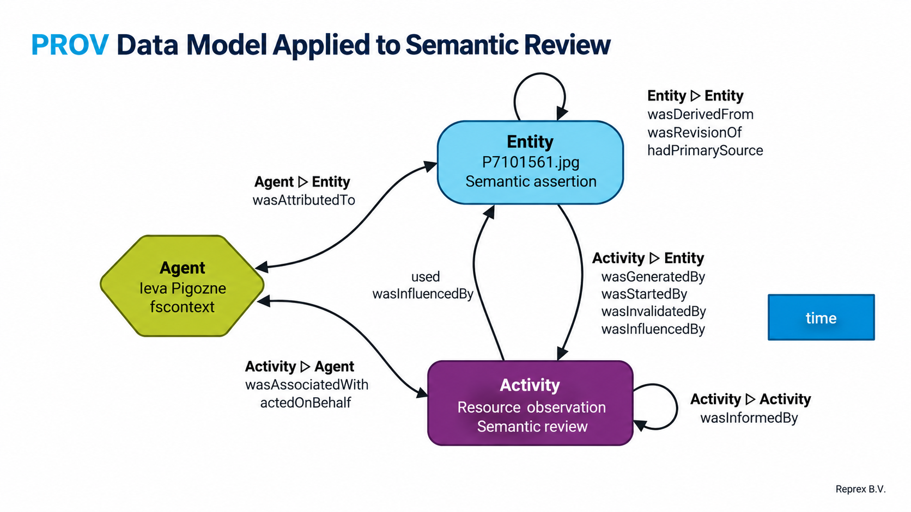
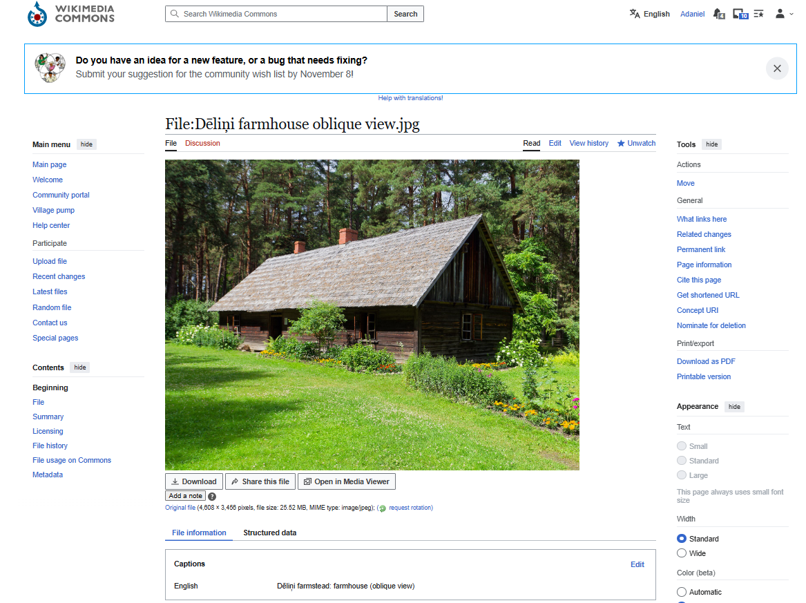
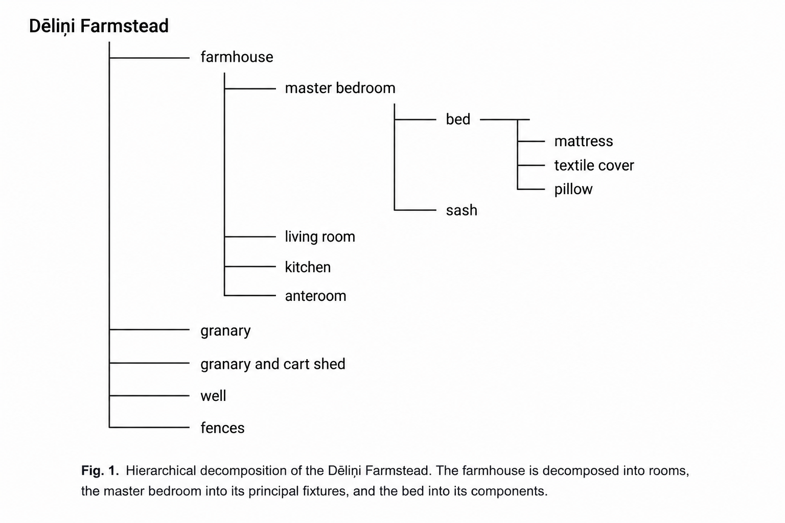

# FinFAIR: Reprex applications

## Introduction

Heritage Digital Twins require more than semantic descriptions of cultural heritage objects. They must support the continuing production, review, maintenance and governance of knowledge derived from heterogeneous documentary evidence. In practice, this knowledge is maintained across institutional databases, knowledge graphs, archival systems and research workflows that cannot reasonably be expected to adopt a single ontology or software environment.

The [Finno-Ugric Data Sharing Space (FUDSS)](https://finnougric.net/) addresses this challenge through an operational architecture combining Wikibase for collaborative knowledge maintenance, Betwixt for provenance-aware knowledge production and review, Apache Jena Fuseki for semantic querying, and Sampo-UI for exploration. Rather than replacing these applications with an HDT-O-specific repository, we propose projecting their maintained knowledge into ontology-aligned representations suitable for exchange with ECHOES.

Our contribution is threefold. First, we demonstrate how existing Wikibase resources can be represented as Heritage Digital Twins (`HC2`) while preserving the distinction between the twins and their represented heritage entities (`HC1`). Second, we propose a workflow connecting reviewed propositions and their provenance to persistent Heritage Proposition Sets (`HC16`). Third, we investigate how documentary works and their digital representations can be independently identified and governed, particularly when rights and permitted uses differ across representations.

Using the **Dēliņi farmhouse and its photographic documentation** as a worked example, this paper presents reproducible RDF representations and identifies both proposed solutions and unresolved questions concerning HDT-O modelling, persistence, provenance and interoperability. Its purpose is to establish a concrete basis for technical discussion, validation and potential collaborative development with ECHOES, rather than to claim conformance with an exchange specification that has not yet been fully established.

The **Finno-Ugric Data Sharing Space (FUDSS)** is a governed cultural heritage data sharing environment built around four complementary applications. Each supports a different aspect of creating, maintaining, reviewing, querying, and sharing knowledge about Heritage Digital Twins[^1].

[^1]: See *Federating Open Knowledge through Wikibase: The Case of The Finno-Ugric Data Sharing Space* [@fudss_2026]

### MediaWiki and Wikibase

We use **MediaWiki and Wikibase** as a collaborative, user-friendly knowledge management environment. Wikibase stores structured statements in a relational database (MariaDB or MySQL) and exposes them as a document-oriented knowledge graph through RDF and SPARQL interfaces.

Wikibase is the software underlying Wikidata, one of the world's largest collaboratively maintained knowledge graphs. Its familiar item-and-property model allows researchers and curators to maintain semantic data without requiring detailed knowledge of RDF or ontology engineering.

Our Wikibase implementation supports bounded federation with Wikidata, Wikimedia Commons, and Wikipedia, allowing locally governed knowledge to be connected to external authority records, media resources, and encyclopaedic descriptions.

### Sampo-UI

**Sampo-UI** is a semantic browsing framework developed at Aalto University and the University of Helsinki. It provides an established approach to exploring humanities knowledge graphs through dynamic faceted search, filtering, and visualisation.

In our implementation, Sampo-UI allows users to query and investigate multimodal heritage knowledge through intuitive interfaces, including tabular views and other projections of the underlying graph.

### Apache Jena Fuseki

**Apache Jena Fuseki** provides our SPARQL query service and API access to the semantic knowledge graph.

It serves as the query backend for our Sampo-UI application and enables authorised users and applications to access the graph programmatically through SPARQL endpoints.

### Betwixt

**Betwixt** is an intermediate representation framework and supporting reference application under development by Reprex. It facilitates the transformation, review, and exchange of semantic knowledge across different data structures, including knowledge graphs, relational databases, spreadsheets, tabular datasets, matrices, tensors, and vector representations.

Betwixt supports bounded federation between independently governed datasets and enables researchers and curators to work with graph-based knowledge without directly manipulating RDF.

For example, users can review, correct, or contribute candidate statements through familiar Excel spreadsheets or tabular HTML interfaces. These changes can be accompanied by provenance and review information before accepted propositions are incorporated into the knowledge graph.

### Finno-Ugric Data Sharing Space

Together, these four applications provide the operational environment of the **Finno-Ugric Data Sharing Space**.

Wikibase supports collaborative knowledge maintenance; Sampo-UI supports exploration and investigation; Fuseki provides semantic query and API services; and Betwixt supports cross-format knowledge exchange, curatorial review, and governed contributions.

**These applications are not themselves the Heritage Digital Twins or the underlying datasets.** They are complementary interfaces and services through which users interact with the knowledge maintained in the data sharing space. Our operational data model is designed to work effectively across these applications while supporting projection into ontology-aligned exchange representations, including HDT-O and CIDOC CRM.

In this document, we refer to a few digital twins developed in the *Finno-Ugric Data Sharing Space*.

The [Dēliņi farmhouse (Q7328)](https://reprexbase.eu/fu/Item:Q7328) is part of the [Dēliņi farmstead (Q5582)](https://reprexbase.eu/fu/Item:Q5582). Two historical photographs, [frontal view with well (Q7362)](https://reprexbase.eu/fu/Item:Q7362) and [oblique view (Q7363)](https://reprexbase.eu/fu/Item:Q7363), depict the farmhouse. Each photograph may have its own digital twin (`HC2`), while its digital image may also serve as a digital representation (`HC5`) of the farmhouse.

```{mermaid}


%%{init: {"theme": "base", "themeVariables": {
  "background": "#ffffff",
  "primaryTextColor": "#263238",
  "lineColor": "#64748b",
  "edgeLabelBackground": "#ffffff",
  "clusterBkg": "#f8fafc",
  "clusterBorder": "#cbd5e1"
}}}%%

flowchart TB
    subgraph P["Heritage objects"]
        direction LR
        FS["Dēliņi farmstead"]
        FH["Dēliņi farmhouse"]
        PH1["Frontal photograph"]
        PH2["Oblique photograph"]
        FH -->|part of| FS
        PH1 -->|depicts| FH
        PH2 -->|depicts| FH
    end

    subgraph T["Heritage Digital Twins · HC2"]
        direction LR
        TFS["Farmstead · Q5582"]
        TFH["Farmhouse · Q7328"]
        TP1["Photograph · Q7362"]
        TP2["Photograph · Q7363"]
    end

    subgraph R["Digital representations · HC5"]
        direction LR
        R1["Frontal digital image"]
        R2["Oblique digital image"]
    end

    FS -.-> TFS
    FH -.-> TFH
    PH1 -.-> TP1
    PH2 -.-> TP2

    PH1 -.-> R1
    PH2 -.-> R2
    R1 -->|represents| FH
    R2 -->|represents| FH

    classDef physical fill:#f1f5f9,stroke:#64748b,color:#1e293b
    classDef twin fill:#dbeafe,stroke:#2563eb,color:#1e3a8a
    classDef representation fill:#dcfce7,stroke:#16a34a,color:#14532d

    class FS,FH,PH1,PH2 physical
    class TFS,TFH,TP1,TP2 twin
    class R1,R2 representation

    style P fill:#f8fafc,stroke:#94a3b8,color:#334155
    style T fill:#eff6ff,stroke:#93c5fd,color:#1e40af
    style R fill:#f0fdf4,stroke:#86efac,color:#166534

```

## Wikibase and Betwixt as operational semantic layers

Our applications use formal semantic models that serve a different purpose from domain ontologies such as HDT-O, CIDOC CRM, the International Council on Archives Records in Contexts Ontology (RiC-O) and DCTERMS[^2].

[^2]: International Council on Archives Records in Contexts Ontology (ICA RiC-O) version 1.1 [@RiC-O_1_1] and the library standard DCTERMS [@dublin_core_dcmi_2020].

These domain ontologies and vocabularies describe cultural heritage objects, archival records, bibliographic resources, their relationships, and their contexts. By contrast, Wikibase and Betwixt provide *operational semantic structures* that help us maintain, exchange, review, and investigate knowledge expressed using different domain models.

The [Wikibase ontology](https://www.mediawiki.org/wiki/Wikibase/DataModel) describes how knowledge is represented within the Wikibase data model, including items, properties, statements, qualifiers, references, and ranks [@wikibase_datamodel]. It enables us to maintain knowledge from different domains in a common, user-friendly environment while preserving mappings to the original domain ontologies.

The [Betwixt Vocabulary](https://usebetwixt.com/articles/betwixt-vocabulary.html), building on Schema.org and PROV-O, supports the intermediate representation and review of knowledge [@antal_betwixt_2026]. [Schema.org](https://schema.org/) provides a widely adopted vocabulary for structured data, while [PROV-O](https://www.w3.org/TR/prov-o/) expresses the W3C PROV Data Model ([PROV-DM](https://www.w3.org/TR/prov-dm/)) for describing entities, activities, agents and their relationships in the production of information. Betwixt supports the transformation of statements from knowledge graphs, relational databases and other data structures into tabular, matrix, tensor or simpler graph representations. Researchers and curators can inspect, correct and warrant claims through familiar interfaces, such as Excel spreadsheets or HTML tables, before accepted knowledge is published back into a graph.

{fig-align="center"}

The Wikibase ontology and Betwixt Vocabulary therefore support applications for data stewards, researchers and educators who possess expertise in cultural heritage but may lack specialised knowledge of RDF, ontology engineering or data programming. For example, a curator can describe the Dēliņi farmhouse in Wikibase, review candidate statements through Betwixt, investigate the resulting knowledge through Sampo-UI and query it through Apache Jena Fuseki. When interoperability requires an explicit HDT-O and CIDOC CRM representation, documented semantic mappings can produce the corresponding exchange structure.

**Our objective is to separate expertise in cultural heritage from expertise in semantic technologies.** Curators, researchers and community experts should be able to contribute and review knowledge using familiar applications, while the underlying semantic infrastructure supports provenance, governance and interoperability across different cultural heritage domains.

### Semantic projection from Wikibase to HDT-O

Wikibase can represent knowledge expressed in HDT-O and CIDOC CRM using its own item-and-property model (see [@pfeiffer_representing_2021; @kesaniemi_wb_cidoc_2022]). Ontology classes can be represented as Wikibase items and ontology properties as Wikibase properties. Class hierarchies can be expressed through *subclass of* relationships, while individual resources can be assigned to classes through *instance of* relationships. Wikibase statements can also carry qualifiers and references. However, representing an ontology within Wikibase and exporting an ontology-aligned RDF graph are distinct operations: the latter requires explicit mappings between Wikibase identifiers and the corresponding ontology classes, properties and relationships.

Our approach distinguishes the *operational representation of heritage knowledge* from its *ontology-aligned exchange representation*. Wikibase allows curators to work with familiar domain-specific classifications and maintain practical descriptions of heritage objects, while documented mappings allow us to project this knowledge into the more explicit conceptual structures of HDT-O and CIDOC CRM[^3]. The operational model does not need to reproduce every ontological distinction as a separately maintained Wikibase item, provided that these distinctions can be reconstructed without ambiguity when required for interoperability.

[^3]: Heritage Digital Twins Ontology [@echoes_hdto_1-1] and the CIDOC Conceptual Reference Model [@cidoc_2024].

In the Finno-Ugric Data Sharing Space, curators generally work with one principal Wikibase item for each heritage object or subject of documentation. This item serves as an operational shorthand for descriptions that HDT-O distinguishes between a Heritage Entity (`HC1`) and its Heritage Digital Twin (`HC2`). It combines statements about the represented entity with information about its classification, relationships, documentation and supporting evidence. For example, the [Dēliņi farmhouse (Q7328)](https://reprexbase.eu/fu/Item:Q7328) and [Dēliņi farmstead (Q5582)](https://reprexbase.eu/fu/Item:Q5582) are maintained as operational digital twins, while also carrying statements that, in a fully articulated HDT-O representation, concern the underlying heritage entities.

This shorthand does not imply that the heritage entity and its digital twin are ontologically identical. Rather, the operational Wikibase item provides a convenient point of access to information that can be attributed to distinct `HC1` and `HC2` resources. We do not systematically create and populate both resources as separate user-facing records, because doing so would introduce additional curatorial work, redundancy and complexity without necessarily improving the everyday management of heritage knowledge. Where the distinction can be established unambiguously, however, the corresponding resources and relationships can be made explicit through semantic projection. The operational representation is therefore deliberately less explicit than the exchange representation, but not intended to contradict it.

To demonstrate this distinction, we also created the [physical Dēliņi farmhouse (Q7376)](https://reprexbase.eu/fu/Item:Q7376) and [physical Dēliņi farmstead (Q7379)](https://reprexbase.eu/fu/Item:Q7379) as separate `HC1` resources. These are connected to their respective digital twins through the Wikibase properties [has digital twin (P484)](https://reprexbase.eu/fu/Property:P484) and its inverse [digital twin of (P482)](https://reprexbase.eu/fu/Property:P482). The local Wikibase item [Q7377](https://reprexbase.eu/fu/Item:Q7377) represents the `HC1 Heritage Entity` class. These additional records make explicit a distinction that would otherwise remain implicit in the operational descriptions.

The essential operational relationships can be illustrated as follows:

```{text}
PREFIX wd:  <https://reprexbase.eu/fu/entity/>
PREFIX wdt: <https://reprexbase.eu/fu/prop/direct/>

# Physical farmhouse and its digital twin
wd:Q7376 wdt:P484 wd:Q7328 .
wd:Q7328 wdt:P482 wd:Q7376 .

# Physical farmstead and its digital twin
wd:Q7379 wdt:P484 wd:Q5582 .
wd:Q5582 wdt:P482 wd:Q7379 .
```

These explicitly modelled `HC1` resources demonstrate that Wikibase can represent the distinction between a heritage entity and its digital twin without requiring a different technical platform. Nevertheless, we regard this as an optional elaboration of the operational model rather than a requirement for every curatorial record. A curator describing the farmhouse generally intends to document the physical building, even though the statements are maintained in a digital information system. Requiring the curator to navigate and maintain two parallel descriptions would often add little practical value. The distinction becomes important when the information is interpreted according to an ontology that assigns different properties and relationships to the heritage entity and its digital twin.

{fig-align="center"}

Our preferred approach is therefore to preserve the established operational identifiers and treat their descriptions as shorthand for the corresponding ontological structures. In an HDT-O-aligned projection, the operational Wikibase item can retain its identity as the `HC2` digital twin, while the represented `HC1` heritage entity is made explicit. The projection may reuse existing `HC1` identifiers, as in this example, or materialise the corresponding resources through documented mappings. This allows the exchange representation to distinguish the physical heritage entities from their digital twins without requiring all such distinctions to be separately maintained in the operational application.

The projection must also account for differences between statements about the operational digital twin and statements about the heritage entity it represents. For example, the operational Wikibase item for the farmhouse records that it is heritage of the [Livonians (Q46)](https://reprexbase.eu/fu/Item:Q46), using the local property `P480`:

```{text}
PREFIX wd:  <https://reprexbase.eu/fu/entity/>
PREFIX wdt: <https://reprexbase.eu/fu/prop/direct/>

wd:Q46 wdt:P14 wd:Q33 .
wd:Q7328 wdt:P480 wd:Q46 .
```

In the operational representation, this statement is attached to the principal Wikibase item because that item serves as the curator's point of access to the farmhouse description. In an HDT-O-aligned representation, however, the heritage relationship concerns the physical farmhouse (`HC1`), rather than its digital twin (`HC2`). The semantic projection therefore attributes the relationship to the corresponding heritage entity while preserving the identity of the operational digital twin:

```{text}
@prefix wd:  <https://reprexbase.eu/fu/entity/> .
@prefix hdt: <https://example.org/hdto/> .
@prefix crm: <http://www.cidoc-crm.org/cidoc-crm/> .

wd:Q7376
    a hdt:HC1, crm:E24_Physical_Human-Made_Thing ;
    hdt:HP1 wd:Q7328 ;
    hdt:HP15 wd:Q46 .

wd:Q7328
    a hdt:HC2 .

wd:Q46
    a crm:E74_Group .
```

The `hdt:` namespace in this illustrative excerpt is a placeholder pending alignment with the authoritative ontology release. The example demonstrates that semantic projection involves more than renaming Wikibase properties. The original statement `Q7328 → P480 → Q46` is interpreted as a heritage relationship between the physical farmhouse (`Q7376`) and the Livonians (`Q46`), while `HP1` explicitly connects the heritage entity to its digital twin. The operational statement is not treated as an erroneous assertion about the digital twin, but as a shorthand whose intended subject can be identified from the modelling context.

This approach depends on the possibility of resolving the shorthand without ambiguity. Some operational statements can be attributed to the heritage entity through straightforward mappings, while others concern the digital twin itself, its documentation, or the processes through which knowledge was produced. Such transformations require documented rules and, where their interpretation is not mechanically determined, appropriate evidence and review. They should not be assumed to be automatically reversible or lossless for every Wikibase statement. Within a defined interoperability profile, however, semantic projection can preserve the relevant identities and meanings while making explicit relationships that remain implicit in the operational application.

The central principle is that *ontological distinctions need not correspond to separately maintained user-facing records*. A Wikibase item can function as a pragmatic shorthand for a more fully articulated HDT-O representation, provided that the underlying distinctions can be reconstructed reliably. Wikibase and Betwixt provide operational environments for maintaining and reviewing knowledge, while semantic projection makes the relevant `HC1` and `HC2` resources, properties and relationships explicit for interoperability.

We believe that our approach reduces rather than introduces confusion for researchers, educators and data stewards. A textile researcher or ethnographer understands that, when working with our Wikibase, Sampo or Betwixt interface, they are not interacting with the physical sash located in the living room of the farmhouse. The digital twin is a volatile digital environment in which we investigate the `HC1` heritage entity indirectly through its `HC2` representation. For ontologists and data engineers, however, it is essential that we can provide an ontologically explicit account distinguishing the farmhouse, its living room and the sash from the digital environment in which they are represented and investigated.

The following worked example develops this approach using the Dēliņi farmhouse, its photographic documentation and persistent proposition sets, with the native Wikibase RDF, intermediate representation and HDT-O projection provided as separate Turtle files.

Let's try to talk briefer. So HC16 is derived from HC15 but must be expressed in formal language of knowledge representation. That qualifies to parts of our Wikidata items serialised in RDF. However, HC15 is not there yet. So, in a very brief, expalin to me the possible classification of the abstract Oblique photo, its ORF file, and three different manifestation each with an ISCC-instance and ISCC-data identifier derived from the bit-by-bit inspection of the manifestaiton I would distinguish five resources: one photographic work, one RAW original, and three derived manifestations.

Resource

Proposed classification

Identity

Abstract oblique photograph

crm:E36 Visual Item; provisionally HC1

Intellectual identity, independent of file format

Original ORF file

HC7 + HC15

Persistent RAW digital object

Manifestation A (e.g. TIFF)

HC7 + HC15

First persistent rendition

Manifestation B (e.g. JPEG)

HC7 + HC15

Second persistent rendition

Manifestation C (e.g. resized JPEG)

HC7 + HC15

Third persistent rendition

Each of the four files can have its own ISCC-INSTANCE and ISCC-DATA identifiers, calculated from its digital content. These identify properties of the files, not the abstract photograph. ISCC-INSTANCE identifies the exact file bytes; ISCC-DATA is content-derived but should not be treated as an exact byte-for-byte identity test.

Three important distinctions:

HC15 identifies persistent digital objects, not necessarily knowledge representations. An ORF or JPEG can qualify.

HC16 specialises HC15 for persistent proposition sets. A formally expressed RDF proposition set can qualify, but an arbitrary RDF serialisation is not automatically an HC16.

HC1/HC2 concern the photographic work and its digital twin, if we provisionally treat the photograph as heritage. They do not need to be assigned to each file manifestation.

Thus, one photographic work can have multiple HC15 manifestations, each independently identifiable, while retaining a single intellectual identity and potentially a single HC2 digital twin.

The remaining modelling question is the precise property connecting those manifestations to the abstract photographic work.

What is the relationship between HC7 and HC15. What is the pro and con of a dual classification? In HDT-O, HC7 and HC15 are two classifications along different dimensions, not subclasses of one another.

HC7 Digital Audiovisual Object describes what the digital object represents: visual or audiovisual content.

HC15 Persistent Digital Object describes how its identity is fixed: complete bit-level content established at a particular creation moment.

Both descend from crmdig:D1 Digital Object, but through different branches. HDT-O does not declare them disjoint.

Dual classification of oblique_view.jpg ex:oblique-jpeg a hdt:HC7, hdt:HC15 . Advantages

Disadvantages

Captures visual content and bit-level persistence simultaneously

Combines representation-level and file-level identity

No additional resource or relationship needed

Can become awkward when one image has multiple renditions

Each manifestation can have its own ISCC identifiers

Queries about HC7 may return individual files rather than distinct visual works

Simple and compatible with the stated class hierarchy

Requires care when attaching rights, authorship and provenance

My recommendation Use dual classification for each fixed ORF, TIFF or JPEG file, but maintain a separate crm:E36 Visual Item for the abstract photograph.

This gives you three clearly distinguishable levels:

E36 — the photographic work, independent of encoding.

HC7 + HC15 — each persistent digital manifestation.

ISCC identifiers — evidence for the identity and content of each manifestation.

I would introduce separate HC7 and HC15 resources only if we need to model a digital visual representation that persists conceptually across several file versions. Otherwise, that extra distinction adds complexity without much benefit.

So , before we go onto the worked example, I want to put this straight after the following text.

Semantic projection from Wikibase to HDT-O Wikibase can represent knowledge expressed in HDT-O and CIDOC CRM using its own item-and-property model (see [@pfeiffer_representing_2021; @kesaniemi_wb_cidoc_2022]). Ontology classes can be represented as Wikibase items and ontology properties as Wikibase properties. Class hierarchies can be expressed through subclass of relationships, while individual resources can be assigned to classes through instance of relationships. Wikibase statements can also carry qualifiers and references. However, representing an ontology within Wikibase and exporting an ontology-aligned RDF graph are distinct operations: the latter requires explicit mappings between Wikibase identifiers and the corresponding ontology classes, properties and relationships.

Our approach distinguishes the operational representation of heritage knowledge from its ontology-aligned exchange representation. Wikibase allows curators to work with familiar domain-specific classifications and maintain practical descriptions of heritage objects, while documented mappings allow us to project this knowledge into the more explicit conceptual structures of HDT-O and CIDOC CRM3. The operational model does not need to reproduce every ontological distinction as a separately maintained Wikibase item, provided that these distinctions can be reconstructed without ambiguity when required for interoperability.

In the Finno-Ugric Data Sharing Space, curators generally work with one principal Wikibase item for each heritage object or subject of documentation. This item serves as an operational shorthand for descriptions that HDT-O distinguishes between a Heritage Entity (HC1) and its Heritage Digital Twin (HC2). It combines statements about the represented entity with information about its classification, relationships, documentation and supporting evidence. For example, the and are maintained as operational digital twins, while also carrying statements that, in a fully articulated HDT-O representation, concern the underlying heritage entities.

This shorthand does not imply that the heritage entity and its digital twin are ontologically identical. Rather, the operational Wikibase item provides a convenient point of access to information that can be attributed to distinct HC1 and HC2 resources. We do not systematically create and populate both resources as separate user-facing records, because doing so would introduce additional curatorial work, redundancy and complexity without necessarily improving the everyday management of heritage knowledge. Where the distinction can be established unambiguously, however, the corresponding resources and relationships can be made explicit through semantic projection. The operational representation is therefore deliberately less explicit than the exchange representation, but not intended to contradict it.

To demonstrate this distinction, we also created the and as separate HC1 resources. These are connected to their respective digital twins through the Wikibase properties and its inverse . The local Wikibase item represents the HC1 Heritage Entity class. These additional records make explicit a distinction that would otherwise remain implicit in the operational descriptions.

The essential operational relationships can be illustrated as follows:

{text} PREFIX wd: \<\> PREFIX wdt: \<\> \# Physical farmhouse and its digital twin wd:Q7376 wdt:P484 wd:Q7328 . wd:Q7328 wdt:P482 wd:Q7376 . \# Physical farmstead and its digital twin wd:Q7379 wdt:P484 wd:Q5582 . wd:Q5582 wdt:P482 wd:Q7379 .

These explicitly modelled HC1 resources demonstrate that Wikibase can represent the distinction between a heritage entity and its digital twin without requiring a different technical platform. Nevertheless, we regard this as an optional elaboration of the operational model rather than a requirement for every curatorial record. A curator describing the farmhouse generally intends to document the physical building, even though the statements are maintained in a digital information system. Requiring the curator to navigate and maintain two parallel descriptions would often add little practical value. The distinction becomes important when the information is interpreted according to an ontology that assigns different properties and relationships to the heritage entity and its digital twin.

We believe

A building in an open-air museum is itself often a "physical twin" of a cultural heritage building or structure. For the user of our digital twins, it is clear that they are not inspecting the original farmhouse, which was relocated to the open air museum in 1971, and not the carefully maintained phyiscal heritage objects and structures, but its digital twin.

Our preferred approach is therefore to preserve the established operational identifiers and treat their descriptions as shorthand for the corresponding ontological structures. In an HDT-O-aligned projection, the operational Wikibase item can retain its identity as the HC2 digital twin, while the represented HC1 heritage entity is made explicit. The projection may reuse existing HC1 identifiers, as in this example, or materialise the corresponding resources through documented mappings. This allows the exchange representation to distinguish the physical heritage entities from their digital twins without requiring all such distinctions to be separately maintained in the operational application.

The projection must also account for differences between statements about the operational digital twin and statements about the heritage entity it represents. For example, the operational Wikibase item for the farmhouse records that it is heritage of the , using the local property P480:

{text} PREFIX wd: \<\> PREFIX wdt: \<\> wd:Q46 wdt:P14 wd:Q33 . wd:Q7328 wdt:P480 wd:Q46 .

In the operational representation, this statement is attached to the principal Wikibase item because that item serves as the curator's point of access to the farmhouse description. In an HDT-O-aligned representation, however, the heritage relationship concerns the physical farmhouse (HC1), rather than its digital twin (HC2). The semantic projection therefore attributes the relationship to the corresponding heritage entity while preserving the identity of the operational digital twin:

```{text} 
@prefix wd: \<\> .
@prefix hdt: \<\> .
@prefix crm: \<\> .
wd:Q7376 a hdt:HC1, 
   crm:E24_Physical_Human-Made_Thing ; 
   hdt:HP1 wd:Q7328 ; 
   hdt:HP15 wd:Q46 . 
   
wd:Q7328 a hdt:HC2 . wd:Q46 a crm:E74_Group .
```


The hdt: namespace in this illustrative excerpt is a placeholder pending alignment with the authoritative ontology release. The example demonstrates that semantic projection involves more than renaming Wikibase properties. The original statement Q7328 → P480 → Q46 is interpreted as a heritage relationship between the physical farmhouse (Q7376) and the Livonians (Q46), while HP1 explicitly connects the heritage entity to its digital twin. The operational statement is not treated as an erroneous assertion about the digital twin, but as a shorthand whose intended subject can be identified from the modelling context.

This approach depends on the possibility of resolving the shorthand without ambiguity. Some operational statements can be attributed to the heritage entity through straightforward mappings, while others concern the digital twin itself, its documentation, or the processes through which knowledge was produced. Such transformations require documented rules and, where their interpretation is not mechanically determined, appropriate evidence and review. They should not be assumed to be automatically reversible or lossless for every Wikibase statement. Within a defined interoperability profile, however, semantic projection can preserve the relevant identities and meanings while making explicit relationships that remain implicit in the operational application.

The central principle is that ontological distinctions need not correspond to separately maintained user-facing records. A Wikibase item can function as a pragmatic shorthand for a more fully articulated HDT-O representation, provided that the underlying distinctions can be reconstructed reliably. Wikibase and Betwixt provide operational environments for maintaining and reviewing knowledge, while semantic projection makes the relevant HC1 and HC2 resources, properties and relationships explicit for interoperability.

We believe that our approach reduces rather than introduces confusion for researchers, educators and data stewards. A textile researcher or ethnographer understands that, when working with our Wikibase, Sampo or Betwixt interface, they are not interacting with the physical sash located in the living room of the farmhouse. The digital twin is a volatile digital environment in which we investigate the HC1 heritage entity indirectly through its HC2 representation. For ontologists and data engineers, however, it is essential that we can provide an ontologically explicit account distinguishing the farmhouse, its living room and the sash

… I think the argument is coherent, but it currently combines three different questions that should be separated before we write the section:

How we store and distribute media, including access restrictions.

How we classify photographs as documentary works and potentially as heritage entities.

How we identify individual digital files within an evolving digital twin.

The strongest way to present this is to move from practical implementation to ontological interpretation.

1.  Media distribution and access governance Our Wikibase is not exclusively a graph of textual statements. It also provides access to photographs, sound recordings, videos and other digital resources.

We use Wikimedia Commons, and where possible Europeana, for material that can be openly distributed under appropriate licences, such as CC BY or CC BY-SA. Other media are maintained through the local Wikibase media extension or alternative access arrangements.

The reason is not simply copyright. A resource may involve several overlapping legal and ethical considerations: copyright, neighbouring rights, personality rights, privacy, consent and culturally sensitive information. A single Creative Commons licence may not adequately express all these conditions.

Important distinction: A media file can be linked to a knowledge graph without its digital content being represented as an independently identified graph resource. We should distinguish the presence of a media attachment from the explicit semantic modelling of that attachment.

I would avoid saying that the graph is multimodal only when files are directly represented as nodes. The system is multimodal in either case; the difference is the depth of semantic integration.

2.  Two different photographic situations I agree with your distinction between two types of photographs, but would formulate it slightly differently.

Type

What is being documented?

Example

Reproduction photograph

An existing documentary or heritage object

Digital reproduction of a historical photographic print

Documentary photograph

A heritage entity in a particular condition, place or moment

Photograph of the Dēliņi farmhouse in 2025

In the first case, we must distinguish the historical photograph as a work, its physical carrier (such as a photographic print), and its digital reproduction.

In the second case, the new photograph is itself a documentary work that represents the farmhouse.

Both situations may involve a photographic work, digital manifestations, rights, provenance and subsequent scholarly interpretation.

3.  Why give contemporary photographs their own digital twins? This is your most interesting argument, and I think it deserves emphasis.

You are proposing that photographs should not be treated merely as passive attachments to the farmhouse's digital twin. They can be independently identifiable objects of investigation.

For example, a photograph of the farmhouse taken in its original location, a photograph taken after reconstruction in the open-air museum, and a photograph taken during an inspection in 2026 have different documentary contexts.

Each may acquire additional knowledge concerning its date, authorship, depicted structures, historical interpretation, authenticity and rights.

Therefore, maintaining a digital twin of the photographic work has a practical justification: the knowledge about the photograph evolves independently of the knowledge about the farmhouse.

However, there is one terminological issue.

HC1 is specifically a Heritage Entity. It is not simply a general class for any independently identifiable intellectual work.

Your proposal is therefore not merely to maintain digital twins for photographs. It is also to treat contemporary heritage documentation as part of the heritage record, regardless of whether an individual photograph has independently acquired historical significance.

That is a defensible curatorial position, but I would present it explicitly as our proposed interpretation of heritage documentation, rather than as an established requirement of HDT-O or European museum practice.

The historical photographs and the 2025–2026 documentation can then all have HC1/HC2 pairs, but for reasons grounded in their documentary role, not because their heritage significance is necessarily identical.

4.  The separate role of HC7 and HC15 This is where I would be particularly precise.

The HC1/HC2 pair identifies the photographic work as an object of investigation and its evolving digital twin.

The HC7/HC15 dual classification identifies a particular fixed digital manifestation.

This allows one photographic work to have an ORF original, a TIFF preservation copy and several JPEG derivatives, each with its own ISCC identifiers.

The key is that the digital twin is volatile, but the individual file manifestations are persistent. They are not persistent because they belong to the twin; their persistence is a property of their fixed digital content.

HC7 and HC15 describe two independent aspects of that same digital object:

HC7: its role as a digital visual or audiovisual representation.

HC15: its identity as a fixed digital object.

This is a stronger explanation than describing HC15 simply as fixing identity within the digital twin.

5.  Suggested structure for the new section I would call it “Multimodal resources and persistent digital representations” and organise it into four short paragraphs:

Distribution and access: Wikimedia Commons, Europeana, local media and rights-sensitive access.

Photographs as documentary works: reproductions of existing records versus new documentation of heritage entities.

Photographs as objects of investigation: why the photographic works themselves can have HC1/HC2 identities, including contemporary documentation.

Persistent manifestations: HC7/HC15, ORF/JPEG/TIFF files and their ISCC identifiers.

One point I would not claim without qualification is that European museum practice requires contemporary object photographs to be recognised as heritage entities. The stronger, more supportable claim is that our model treats them as integral documentary components of the heritage record, whose independent provenance, rights and evolving interpretation justify their own digital twins.

That gives you a coherent argument without conflating heritage status, documentary identity, digital representation and bit-level persistence.

Pasted text(20261102-155622).txt Document OK, can you please create such a new text, but using our ongoing examples , the oblique and frontal photograph The following section is intended to follow Semantic projection from Wikibase to HDT-O, immediately before the worked example.

### Multimodal resources and persistent digital representations

The *Finno-Ugric Data Sharing Space* maintains a multimodal heritage knowledge environment in which photographs, sound recordings, videos and other digital resources can be connected to the knowledge graph. Where the relevant rights permit public distribution, we publish media through Wikimedia Commons, and where possible make them available through Europeana, using licences such as [CC BY](https://creativecommons.org/licenses/by/4.0/) or [CC BY-SA](https://creativecommons.org/licenses/by-sa/4.0/).

[{fig-align="center"}](https://commons.wikimedia.org/wiki/File:D%C4%93li%C5%86i_farmhouse_oblique_view.jpg)

For resources that cannot be distributed under these conditions, we use the [Wikibase Local Media](https://www.mediawiki.org/wiki/Extension:Wikibase_Local_Media "Wikibase Local Media Extension") extension or provide alternative access arrangements, for example, with some sound recordings on Spotify. Such restrictions may arise from overlapping copyright, neighbouring rights, personality rights, privacy obligations, contractual permissions or ethical considerations that cannot be adequately expressed through a single licence statement.

These arrangements distinguish access to digital media from their explicit representation in the knowledge graph. Some files are linked to Wikibase records as external or locally managed media resources without being individually modelled as graph entities. Others are independently identified and described within the graph, allowing their provenance, technical characteristics, relationships and permitted uses to be investigated. Both arrangements support a multimodal environment, but they differ in the extent to which the digital resources themselves participate in semantic relationships.

Photographic documentation provides a relatively straightforward example of these distinctions. Our collections include digital reproductions of existing documentary objects, such as historical photographic prints, and contemporary photographs documenting the present condition of heritage entities. In the former case, the historical photograph, its physical carrier and its digital reproduction may require distinct descriptions.

In the latter case, a newly created photographic work documents a heritage entity from a particular viewpoint and at a particular moment. The [frontal photograph (Q7362)](https://reprexbase.eu/fu/Item:Q7362) and [oblique photograph (Q7363)](https://reprexbase.eu/fu/Item:Q7363) of the Dēliņi farmhouse illustrate this second category.

We regard these photographs as integral documentary components of the heritage record rather than merely as illustrations attached to the farmhouse description. Photographs showing the farmhouse in its original location, after its relocation and reconstruction in the open-air museum in 1971, or during contemporary inspections during the feasibility assessment of FinFAIR or during our FinFAIR Echoes project provide evidence of different historical and physical conditions. Their authorship, provenance, interpretation, rights and evidential significance may also be investigated and revised independently of the farmhouse itself. We therefore propose treating photographic works used in heritage documentation as independently identifiable entities with their own digital twins, while recognising that their classification as `HC1 Heritage Entity` requires an explicit interpretation of their heritage status.

In our operational model, the frontal and oblique photographs have their own Wikibase identifiers, [`Q7362`](https://reprexbase.eu/fu/Item:Q7362) and [`Q7363`](https://reprexbase.eu/fu/Item:Q7363), which serve as their digital twins (`HC2`). These twins maintain evolving knowledge about the photographic works, including their creation, interpretation, provenance and rights. The corresponding photographic works are provisionally classified as `HC1` resources in our HDT-O projection. This allows us to apply the existing heritage digital-twinning model to contemporary documentary works, while leaving open the question of whether HDT-O should support digital twins of intellectual creations without requiring their prior recognition as heritage.

The photographic works must also be distinguished from their individual digital manifestations. Both the frontal and oblique photographs were originally captured as Olympus RAW (`ORF`) files, from which TIFF, JPEG, PNG and other derivatives can be produced. The RAW files preserve the original photographic capture data and allow different interpretations of exposure, colour, contrast and other image characteristics during processing. The resulting manifestations do not normally constitute separate photographic works. Rather, they are different digital representations of the same intellectual creation, potentially with different technical characteristics, visual appearances, access conditions and permitted uses.

For fixed digital manifestations, we propose a dual classification using `HC7 Digital Audiovisual Object` and `HC15 Persistent Digital Object`. These classes describe complementary aspects of the same resource. `HC7`, a subclass of `HC5 Digital Representation`, identifies its visual or audiovisual representational character, while `HC15` identifies a digital object whose complete bit-level content was fixed at a particular creation moment. The classes are not mutually exclusive, and neither is a subclass of the other. Consequently, the original `ORF` file of the oblique photograph and each of its fixed TIFF, JPEG or PNG derivatives can be classified as both `HC7` and `HC15`, without treating them as separate photographic works or digital twins.

We identify these manifestations using the International Standard Content Code (ISCC), a family of ISO-standardised, content-derived digital identifiers [@iscc_2024], whose application is also being promoted in European copyright infrastructure initiatives, including work associated with the European Union Intellectual Property Office and the Copyright Infrastructure Task Force [@citf_2025]. Each fixed manifestation can receive an ISCC-INSTANCE identifier derived from its exact file bytes and an ISCC-DATA identifier derived from its digital data. These identifiers help distinguish individual files even when they represent the same photographic work.

The ISCC system also provides ISCC-CONTENT and ISCC-META components, which support comparison of perceptual content and descriptive metadata across manifestations. In our workflow, the original `ORF` files are treated primarily as photographic source files from which multiple renditions can be generated. Their ISCC identification therefore focuses on the available file-level and data-level components. The rendered JPEG, PNG and TIFF manifestations can additionally be analysed for their visual content and embedded metadata. Different renditions of the same photograph may consequently have closely related ISCC-CONTENT identifiers despite differences in resolution, compression, colour processing or file format. Their ISCC-META identifiers may also be similar, although metadata conventions and supported fields differ between formats. Such similarities are useful for identifying relationships between manifestations, but do not establish that their bit-level contents are identical.

These identifiers concern the digital manifestations, rather than the abstract photographic work or its evolving digital twin. The `ORF` file is particularly important as the original digital negative from which different visual renditions can be produced, but it remains a fixed digital manifestation rather than the intellectual work itself. The photographic twin can therefore maintain changing knowledge about the work while its individual manifestations remain independently identifiable persistent digital objects.

The dual classification also supports rights-aware governance. The original high-resolution `ORF` file of the oblique photograph may be retained for authorised inspection, while a JPEG derivative may be approved for public distribution. A cropped detail, reduced-resolution image or differently processed rendition may require a separate assessment of its permitted uses. The photographic twin maintains evolving propositions about these conditions, while the individual `HC7` and `HC15` resources identify the manifestations to which particular permissions, restrictions and technical descriptions apply. Rights in the underlying photographic work remain distinguishable from permissions governing the distribution or use of particular files.

Our approach therefore distinguishes three levels: the photographic work as an independently identifiable subject of investigation, its evolving digital twin (`HC2`), and its persistent digital manifestations (`HC7` and `HC15`). This structure allows the frontal and oblique photographs to serve as evidence in the digital twin of the Dēliņi farmhouse without losing their independent identity, provenance or governance context. Although photographs provide the clearest demonstration, the same distinctions are relevant to sound recordings, musical notation, video and three-dimensional digital representations, where the relationships between intellectual works, digital manifestations and permitted uses may be considerably more complex.


# Worked example: projecting operational knowledge into HDT-O

The Dēliņi farmhouse provides an initial demonstration of how independently maintained Wikibase records can be projected into an HDT-O and CIDOC CRM representation. The example distinguishes physical heritage entities, their digital twins, independently identifiable photographic works, fixed digital manifestations and proposition sets. It is intended as a first consultation draft for discussion with ECHOES, rather than a final modelling recommendation or validated interoperability package.

Three complementary RDF examples are maintained in the [FinFAIR Data Exchange repository](https://github.com/dataobservatory-eu/finfair-data-exchange/tree/main/ttl):

- [wikibase-Q7328.ttl](https://github.com/dataobservatory-eu/finfair-data-exchange/blob/main/ttl/wikibase-Q7328.ttl) — the native Wikibase RDF representation, preserving operational identifiers, properties and statements.
- [intermediate-Q7328.ttl](https://github.com/dataobservatory-eu/finfair-data-exchange/blob/main/ttl/intermediate-Q7328.ttl) — an intermediate representation combining selected operational Wikibase statements with HDT-O and CIDOC CRM annotations.
- [hdt-Q7328.ttl](https://github.com/dataobservatory-eu/finfair-data-exchange/blob/main/ttl/hdt-Q7328.ttl) — the proposed semantic projection into HDT-O and CIDOC CRM, without the native Wikibase export statements.

The intermediate and final examples have been revised to distinguish photographic works from their fixed digital manifestations and to introduce the complementary `HC7` and `HC15` classifications. The following excerpts reflect these revised files; the repository links should be updated with the corrected versions before circulation. The examples preserve existing Reprexbase identifiers where available. The `hdt:` namespace remains illustrative, and the files have been checked for Turtle syntax but not yet validated against authoritative HDT-O ontology constraints or ECHOES SHACL shapes.

## Heritage entities and digital twins

The physical Dēliņi farmhouse and farmstead are distinguished from their operational digital twins. The `HP1` property connects each heritage entity (`HC1`) to its digital twin (`HC2`). The physical farmhouse is also explicitly represented as part of the physical farmstead using the CIDOC CRM property `P46i forms part of`.

```{text}
wd:Q7376
    a hdt:HC1, crm:E24_Physical_Human-Made_Thing ;
    hdt:HP1 wd:Q7328 ;
    hdt:HP15 wd:Q46 ;
    crm:P46i_forms_part_of wd:Q7379 .

wd:Q7379
    a hdt:HC1, crm:E24_Physical_Human-Made_Thing ;
    hdt:HP1 wd:Q5582 .

wd:Q7328 a hdt:HC2 .
wd:Q5582 a hdt:HC2 .
```

The identifiers `Q7328` and `Q5582` remain the operational digital twins used by curators. The separately identified physical entities, `Q7376` and `Q7379`, make explicit the distinction between the heritage objects and the digital environments through which they are investigated. The relationship between the physical farmhouse and farmstead is not assumed to imply an identical composition relationship between their digital twins.

The intermediate representation also preserves selected native Wikibase assertions, including the operational relationship between the farmhouse and farmstead and the attribution of the farmhouse to Livonian heritage. Their interpretation as relationships between physical heritage entities is made explicit in the HDT-O projection. Where source statements appear inconsistent with the intended meaning of a Wikibase property, they require separate verification rather than silent correction during projection.

## Photographic works, digital twins and persistent manifestations

The frontal and oblique photographs of the Dēliņi farmhouse are independently identifiable documentary works. They depict the same physical heritage entity but have different photographic viewpoints and may have different creation histories, interpretations, rights and permitted uses. Their operational Wikibase identifiers, [`Q7362`](https://reprexbase.eu/fu/Item:Q7362) and [`Q7363`](https://reprexbase.eu/fu/Item:Q7363), are retained as the identifiers of their digital twins.

In the current example, each photographic work is provisionally classified as `HC1 Heritage Entity` and `crm:E36 Visual Item`, while its digital twin is classified as `HC2 Heritage Digital Twin`. This permits us to test the existing HDT-O relationships without introducing an additional ontology class. It does not settle whether every contemporary photographic work used in heritage documentation should itself be recognised as a heritage entity.

```{text}
ex:frontal-photographic-work
    a hdt:HC1, crm:E36_Visual_Item ;
    hdt:HP1 wd:Q7362 ;
    crm:P138_represents wd:Q7376 .

wd:Q7362 a hdt:HC2 .

ex:oblique-photographic-work
    a hdt:HC1, crm:E36_Visual_Item ;
    hdt:HP1 wd:Q7363 ;
    crm:P138_represents wd:Q7376 .

wd:Q7363 a hdt:HC2 .
```

The photographic works are further distinguished from their digital manifestations. Both photographs originated as Olympus RAW (`ORF`) files, from which TIFF, JPEG and other renditions may be generated. The original RAW file and each fixed derivative can have a persistent digital identity without becoming a separate photographic work or digital twin.

For the published JPEGs, our revised projection proposes a dual classification as `HC7 Digital Audiovisual Object` and `HC15 Persistent Digital Object`. These classes describe complementary aspects of the same resource: its character as a digital visual representation and its identity as a digital object with fixed bit-level content. The dual classification is intended to avoid introducing separate resources merely to express these two characteristics.

```{text}
ex:frontal-jpeg
    a hdt:HC7, hdt:HC15 ;
    hdt:HP9 wd:Q7376 .

ex:oblique-jpeg
    a hdt:HC7, hdt:HC15 ;
    hdt:HP9 wd:Q7376 .

ex:frontal-photographic-work
    ex:hasManifestation ex:frontal-jpeg .

ex:oblique-photographic-work
    ex:hasManifestation ex:oblique-jpeg .

wd:Q7362
    ex:hasDigitalRepresentation ex:frontal-jpeg .

wd:Q7363
    ex:hasDigitalRepresentation ex:oblique-jpeg .
```

In this proposal, `HP9` expresses the visual depiction of the physical farmhouse. It is distinguished from the application-specific `ex:hasManifestation` property, which connects a photographic work to a particular digital manifestation, and `ex:hasDigitalRepresentation`, which associates the photographic twin with that manifestation. The latter two properties are not presented as part of HDT-O. The precise constraints and suitability of `HP9` remain to be confirmed against the authoritative ontology.

The distinction between the photographic work and its manifestations is also relevant to digital identification. We envisage assigning ISCC identifiers to individual fixed files, including ISCC-INSTANCE and ISCC-DATA components [@iscc_2024]. Additional ISCC components may support comparisons of perceptual content and metadata across renditions. The original `ORF` file, a preservation TIFF and a published JPEG can thus remain separately identifiable while being associated with the same photographic work. The current RDF examples do not yet include the RAW originals, TIFF derivatives or calculated ISCC identifiers, because these must be derived from the actual files rather than invented for illustration.

The same distinction supports rights-aware governance. A photographic work may be subject to copyright and attribution requirements, while its original RAW file, high-resolution preservation copy and publicly distributed JPEG may be subject to different access and reuse arrangements. The photographic twin provides an evolving environment for maintaining knowledge about these conditions, while the persistent manifestations identify the particular digital resources to which permissions and restrictions apply.

## Persistent heritage proposition sets

The revised RDF examples also illustrate how digital twins can be associated with independently identified proposition sets. HDT-O provides `HC16 Heritage Proposition Set`, a specialisation of `HC15 Persistent Digital Object`, and `HP33` for associating a digital twin with its currently contained proposition sets.

The farmhouse and the two photographic twins are each associated with a version-labelled proposition set. For the farmhouse, the example includes propositions concerning Livonian heritage attribution and membership of the farmstead. The photographic examples include propositions concerning the published JPEGs and their relationships to the photographic twins.

```{text}
wd:Q7328
    hdt:HP33 ex:delini-building-ps-v1 .

ex:delini-building-ps-v1
    a hdt:HC16 ;
    ex:hasProposition
        ex:delini-livonian-heritage-claim,
        ex:delini-farmstead-membership-claim .

ex:delini-livonian-heritage-claim
    a rdf:Statement ;
    rdf:subject wd:Q7376 ;
    rdf:predicate hdt:HP15 ;
    rdf:object wd:Q46 .
```

The reified proposition records the interpretation that the physical farmhouse, rather than its digital twin, is heritage of the Livonians. The `ex:hasProposition` predicate and RDF statement reification are application-specific mechanisms for identifying proposition-set members; they are not proposed as mandatory HDT-O constructs.

Importantly, these examples do not yet demonstrate complete persistent proposition-set serialisation. Although the resources are provisionally classified as `HC16`, their full contents, boundaries, fixation mechanisms and subsequent preservation have not been established. The examples therefore demonstrate the intended relationship between an evolving digital twin and persistent knowledge states, rather than a completed implementation of `HC16`.

This distinction is particularly important for Betwixt. Candidate propositions can be inspected, corrected and reviewed before their acceptance into operational knowledge. Review records, evidence and decisions may be preserved independently of the current state of a digital twin. An accepted proposition set can subsequently be replaced without losing the identity of the earlier set. The precise representation of these transitions, including the use of `HP34` for former proposition sets, remains a subject for consultation.

## Implications for ECHOES interoperability

These examples illustrate a possible separation between operational knowledge maintenance and ontology-aligned exchange. Wikibase provides practical identifiers and descriptions, Betwixt supports the review of candidate knowledge, and semantic projection makes relevant ontological distinctions explicit without requiring curators to maintain all such distinctions as separate operational records.

The revised examples also demonstrate why a digital twin should not be conflated with its digital representations. The Dēliņi farmhouse has its own digital twin, while the frontal and oblique photographic works can have independently maintained twins and multiple persistent file manifestations. A JPEG may provide evidence about the farmhouse while also being a manifestation of a separately identifiable photographic work.

Our immediate objective is to determine which of these relationships can be expressed using existing HDT-O classes and properties, which require agreed implementation conventions, and which reveal conceptual gaps that may justify ontology extensions. The examples are therefore offered as a basis for technical consultation and collaborative validation rather than as a final interoperability model.

# Proposed solutions and open questions for ECHOES interoperability

The Finno-Ugric Data Sharing Space (FUDSS) provides an operational environment for creating, reviewing, maintaining and exchanging knowledge about cultural heritage. The Dēliņi examples allow us to formulate a set of specific implementation proposals and questions for ECHOES. The status descriptions below indicate our current assessment, not a claim that the proposed solutions have been formally accepted or validated.

### 1. Operational Wikibase items as Heritage Digital Twins

**Status: Proposed implementation pattern — ontology alignment to be confirmed.**

We propose retaining existing Wikibase items as operational identifiers of `HC2 Heritage Digital Twin` resources. For example, the Dēliņi farmhouse (`Q7328`) retains its established operational identity, while the physical farmhouse (`Q7376`) is separately represented as an `HC1 Heritage Entity`. The relationship is expressed through `HP1 has digital twin`.

This allows curators to work with familiar Wikibase records while semantic projection provides the distinctions needed for ontology-aligned exchange. The projection preserves the original identifiers and does not require all `HC1` resources to be separately maintained as user-facing records.

**Questions for ECHOES:** Is this approach compatible with the intended identity and lifecycle semantics of `HC2`? Are there additional requirements for establishing, maintaining or exchanging the identity of a Heritage Digital Twin beyond the relationships illustrated here?

### 2. Photographic works and persistent digital manifestations

**Status: Proposed implementation pattern — representation semantics require confirmation.**

The revised Dēliņi example distinguishes the photographic work, its digital twin and its fixed digital manifestations. The frontal and oblique photographic twins retain their Reprexbase identifiers (`Q7362` and `Q7363`). Their published JPEGs are separately identified and provisionally classified as both `HC7 Digital Audiovisual Object` and `HC15 Persistent Digital Object`.

We propose that this dual classification describes two complementary characteristics of the same digital manifestation, without requiring separate `HC7` and `HC15` resources. It also allows individual files to be assigned content-derived identifiers while preserving the identity of the photographic work independently of its encodings.

The example uses `HP9` for the JPEG's visual depiction of the farmhouse and introduces application-specific relationships between the photographic work, its twin and its manifestations.

**Questions for ECHOES:**

- Is dual classification as `HC7` and `HC15` appropriate for a fixed photographic manifestation, including RAW originals and rendered derivatives?
- Is `HP9` the appropriate property for expressing that a digital photograph depicts a physical heritage entity?
- Does HDT-O provide a preferred relationship between a photographic work and its individual digital manifestations, or between a photographic twin and those manifestations?
- How should persistent file identities and content-derived identifiers, including ISCC, be represented in an interoperable HDT-O exchange?

### 3. Extending digital twinning beyond recognised heritage

**Status: Open conceptual proposal.**

Our current example provisionally classifies contemporary photographic works as `HC1 Heritage Entity` so that their digital twins can be represented as `HC2`. This is a practical accommodation for testing the existing ontology, but it raises a broader conceptual question.

Contemporary photographs, musical compositions, sound recordings and other intellectual creations may require independently maintained knowledge, provenance and rights governance before they acquire recognised heritage significance. Their digital twins should not necessarily depend on an initial classification of the underlying works as heritage.

We therefore propose considering a more general `Digital Twin` superclass, with `HC2 Heritage Digital Twin` as its heritage-specific subclass. This would allow a contemporary cultural work to maintain a digital twin throughout its lifecycle and subsequently acquire a more specific heritage classification without changing its identity or losing its knowledge history.

This is a proposed extension rather than a claim about the existing HDT-O class hierarchy.

**Question for ECHOES:** Would a general `Digital Twin` superclass be compatible with the intended development of HDT-O? If not, what mechanism would be preferable for independently governed digital twins of contemporary cultural works?

### 4. Reviewed propositions and persistent proposition sets

**Status: Proposed modelling pattern — persistence and exchange representation remain open.**

Betwixt supports the creation, inspection, correction and review of candidate propositions. Accepted propositions can be published as operational Wikibase statements, while review datasets preserve the evidence, decisions and provenance associated with their production.

We propose representing persistent states of accepted knowledge through `HC16 Heritage Proposition Set` resources associated with a digital twin using `HP33`. The Dēliņi examples use version-labelled proposition-set identifiers and application-specific RDF reification to demonstrate this arrangement.

However, `HC16` is a specialisation of `HC15`. Its use therefore requires more than identifying a collection of statements: the complete proposition set must have a persistent identity and a defined, fixed content. The current examples do not yet implement these requirements.

**Questions for ECHOES:**

- What is the recommended interoperable representation of the complete contents of an `HC16` proposition set?
- Should proposition sets be represented as named graphs, independently identified RDF resources, persistent serialisations or another specified structure?
- How should their identity and persistence be established when the same propositions can be serialised in different RDF formats?
- Are there recommended mechanisms for connecting individual reviewed propositions to an `HC16` set without prescribing a particular application-level review vocabulary?

### 5. Current, former and rejected propositions

**Status: Proposed interpretation — lifecycle semantics require confirmation.**

Our workflow distinguishes candidate propositions, accepted propositions, superseded propositions and propositions rejected during review.

We propose that only accepted knowledge enters the current proposition sets of a digital twin. When an accepted set is replaced, the former set remains identifiable as part of the twin's history. Candidate or rejected propositions that were never accepted remain in the Betwixt review record rather than automatically becoming historical contents of the digital twin.

This separates the history of knowledge production from the history of knowledge maintained by the twin. The current RDF examples demonstrate `HP33` but do not yet implement the replacement or historical relationships.

**Question for ECHOES:** Does `HP34` refer specifically to proposition sets formerly contained in a digital twin, or can it also describe candidate or rejected proposition sets that were never accepted into the twin?

### 6. Provenance of reviewed knowledge

**Status: Proposed operational approach — HDT-O integration remains open.**

We use PROV-O to describe the agents, activities and evidence involved in producing and reviewing propositions. Betwixt review documents can be maintained as persistent digital resources, while accepted proposition sets may be derived from one or more review activities.

This permits the provenance of a knowledge claim to be maintained separately from its current operational assertion. It also allows different reviewers and sources to contribute to knowledge subsequently maintained by a digital twin.

The revised Dēliņi examples identify propositions but do not yet represent their complete review activities, evidence or competent warrants.

**Question for ECHOES:** Is PROV-O sufficient for representing the derivation and review provenance of `HC16` proposition sets from persistent review documents, potentially classified as `HC15`, or does HDT-O envisage more specific relationships and constraints?

### 7. Physical composition and digital twin composition

**Status: Partially modelled — composition semantics remain open.**

The Dēliņi farmhouse is physically part of the Dēliņi farmstead. Our projection represents this relationship using CIDOC CRM `P46i forms part of`. The farmhouse and farmstead also have independently identified digital twins, each potentially maintaining its own proposition sets, representations and governance arrangements.

We do not assume that physical part–whole relationships automatically determine digital twin composition. A physical object may participate in different documentary, historical or scholarly contexts, and its digital twin may therefore participate in several investigative environments.

**Questions for ECHOES:**

- Is `HP3` intended to represent independently established digital twin composition rather than automatically following physical part–whole relationships?
- Does a component digital twin contribute its `HC16` proposition sets to a composite twin, or are those sets maintained independently?
- Can a digital twin participate in multiple composite twins without duplicating its propositions?

The last question is particularly relevant to archival records that participate in overlapping or changing archival arrangements.

### 8. Digital twin snapshots, revisions and persistence

**Status: Open implementation question.**

Our Wikibase environment maintains evolving statements and revision histories, while Betwixt can preserve review datasets and their provenance. These mechanisms provide a basis for reconstructing changes in accepted knowledge.

However, the Dēliņi RDF examples do not yet establish a complete snapshot mechanism or demonstrate that Wikibase revisions and Betwixt records satisfy the intended semantics of `HP28`. Similarly, the version-labelled `HC16` proposition sets remain illustrative until their complete persistent contents can be established.

**Questions for ECHOES:**

- Are persistent snapshots an essential requirement of an `HC2` digital twin or an optional mechanism?
- What constitutes a complete snapshot: the current proposition sets, digital representations, provenance, governance information or some specified combination?
- How should snapshots relate to independently persistent `HC15` manifestations and `HC16` proposition sets?
- Is there a recommended exchange package for current and historical states of a digital twin?

### 9. Interoperability with archival and library ontologies

**Status: Open interoperability question.**

Our heritage data includes archival records, record sets, bibliographic resources and documentary collections whose semantics may be more appropriately expressed through Records in Contexts (RiC-O) or DCTERMS than through CIDOC CRM alone.

We do not propose replacing these domain descriptions with HDT-O classes. Instead, we envisage preserving their established semantic structures while identifying the relationships needed for participation in Heritage Digital Twins.

This is particularly important for archival provenance, record aggregation, changing arrangements and the distinction between records and the entities they document.

**Questions for ECHOES:**

- Can RiC-O entities and relationships participate directly in an HDT-O digital twin without losing their archival semantics?
- Are recommended mappings or interoperability patterns envisaged for RiC-O, DCTERMS and other domain vocabularies?
- Can an `HC16` proposition set contain propositions expressed using several domain ontologies, provided their semantics and provenance are preserved?

### 10. Rights-aware governance of documentary representations

**Status: Proposed operational approach — ontology alignment remains open.**

We propose maintaining independently identifiable digital twins for documentary works when their authorship, provenance, interpretation, rights or permitted uses require investigation and governance.

The frontal and oblique photographs illustrate why rights concerning an intellectual work should be distinguished from access and reuse conditions concerning its digital manifestations. An original RAW file may be retained for authorised inspection, while a JPEG rendition may be approved for public distribution. Other renditions may be subject to different restrictions or permissions.

These conditions may involve copyright, neighbouring rights, personality rights, privacy, consent, contractual obligations and ethical considerations. They cannot always be reduced to a single licence attached to the photographic work or its digital twin.

Our proposed model therefore associates rights-related propositions with the relevant subjects: the photographic work, its digital manifestations, the agents holding rights or responsibilities, and the activities or uses being authorised. Betwixt can support the review and revision of these propositions as new evidence or permissions become available.

The current RDF examples establish the identities and relationships needed for such governance but do not yet encode specific rights decisions or permissions.

**Questions for ECHOES:**

- Is there a recommended HDT-O integration pattern for rights and permissions expressed through ODRL, PROV-O or related vocabularies?
- How should rights in an underlying cultural work be distinguished from permissions and restrictions applying to particular `HC7`/`HC15` manifestations?
- Can purpose-specific rights decisions be maintained as reviewed propositions within `HC16` sets, including uncertainty, restrictions, supporting evidence and the authority responsible for the decision?

## Proposed validation and interoperability work

We do not envisage replacing Wikibase with an ECHOES-specific repository. Instead, we propose developing a reproducible RDF projection from the operational Wikibase and Betwixt environment into the ontology structures expected by ECHOES.

The Dēliņi examples provide a deliberately small initial test case. The corrected intermediate and final Turtle files establish a concrete starting point for discussion, but syntax validity should not be confused with ontology conformance or a completed exchange implementation.

For the next stage, we would particularly appreciate:

1. **Authoritative ontology releases.** A versioned, machine-readable HDT-O specification with stable namespace IRIs, class and property definitions, and documented changes between releases.

2. **SHACL validation shapes.** Reference shapes describing the structural and semantic constraints expected of HDT-O-compatible RDF exchange, including constraints on `HC7`, `HC15`, `HC16` and their relevant relationships.

3. **Positive and negative test cases.** Representative examples with expected validation outcomes, including dual-classified digital manifestations, independently maintained photographic twins, proposition sets and provenance.

4. **EARL reporting guidance.** A recommended approach for reporting which interoperability and conformance tests our projection passes or fails.

5. **A complete exchange example.** A valid Heritage Digital Twin exchange package illustrating current and historical proposition sets, persistent digital representations, provenance and, where applicable, rights information.

6. **A collaborative mapping exercise.** We propose using the Dēliņi farmhouse and its frontal and oblique photographic documentation as a small reference case for jointly testing the projection, identifying ontology gaps and documenting agreed interoperability patterns.

Our immediate objective is not to extend HDT-O wherever existing classes and properties can already express the required meaning. We seek to distinguish requirements that can be met through documented mappings, requirements that need additional implementation conventions, and genuine conceptual gaps that may justify extending the ontology.

The Finno-Ugric Data Sharing Space could thereby serve as a practical interoperability demonstrator for ECHOES while preserving its independently governed operational knowledge environment.

# Extending Heritage Digital Twins to the full lifecycle of cultural creation and preservation

The FinFAIR project commits Reprex to developing **rights-aware Heritage Digital Twins**, incorporating legal, ethical and institutional governance into the evolving knowledge maintained about cultural heritage entities.

Our experience suggests that similar requirements arise throughout the lifecycle of contemporary cultural works. Photographs, musical compositions, recorded performances and other intellectual creations have identifiable subjects, persistent identities, evolving bodies of knowledge and rights that may require investigation and governance before the works are formally recognised as cultural heritage.

The Dēliņi farmhouse and its frontal and oblique photographs illustrate this distinction. The farmhouse is a physical heritage entity. The photographs are independently identifiable intellectual creations that also serve as evidence about the farmhouse. Each can be investigated, described and governed through its own digital twin.

The photographs originate as Olympus RAW digital negatives from which TIFF, JPEG and other renditions may be produced. These fixed manifestations can be modelled as `HC7` and `HC15` resources, while the photographic works retain their intellectual identities independently of particular files. The digital twins maintain evolving knowledge about the works, including their creation, interpretation, provenance, rights and permitted uses.

We therefore distinguish three levels:

1. **The represented entity:** a physical heritage object or independently identifiable intellectual work, such as a farmhouse, photograph, musical composition or recorded performance.
2. **Its Digital Twin (`DT`):** an evolving, governed environment for maintaining and investigating knowledge about that entity, including propositions concerning its identity, interpretation, provenance, rights and permitted uses.
3. **Its persistent digital manifestations:** particular files, renditions or other digital resources used to inspect, analyse, reproduce or communicate the represented entity, potentially classified as both `HC7` and `HC15` where appropriate.

For recognised heritage entities, the digital twin can be classified as `HC2 Heritage Digital Twin`. For other cultural works, we propose considering a more general `Digital Twin` class, with `HC2` as its heritage-specific subclass. If a cultural work subsequently acquires recognised heritage significance, its existing twin could receive the more specific classification without changing its identity or reconstructing its knowledge history.

This proposal does not require every digital file to become a digital twin. Nor does it diminish the heritage-specific concepts of HDT-O. It seeks to generalise the digital-twinning mechanism while retaining Heritage Digital Twins as a specialised application.

The extension would be particularly useful for rights-aware governance. The rights associated with a photographic work, its original RAW file, its published JPEG and its use as evidence in the investigation of another heritage entity may differ. Maintaining a separate digital twin for the photographic work allows these conditions to be investigated and revised independently of the farmhouse's digital twin.

We offer this as a conceptual proposal for consultation with ECHOES, not as an already established extension of HDT-O. Our aim is to determine whether the existing ontology can accommodate these requirements through agreed modelling patterns or whether a more general digital-twinning concept would provide a clearer foundation for managing cultural works throughout their creation, preservation and eventual recognition as heritage.

### Rights-aware digital twins of documentary evidence

Our implementation hypothesis extends to the documentary resources used in constructing Heritage Digital Twins. We propose that photographs, manuscripts, drawings, sound recordings, audiovisual works and other documentary resources should have **independently maintained digital twins when their rights, provenance or permitted uses require investigation and governance**.

This is particularly important when a resource is not clearly in the public domain or available under a licence that permits its intended use.

For relatively simple cases, a public-domain declaration or an appropriate Creative Commons licence may provide a practical basis for reuse. However, many cultural resources involve more complex rights. Musical and audiovisual works may combine copyright in compositions, scripts and other creative contributions with performers' neighbouring rights and producers' rights in recordings. Historical manuscripts may involve several authors, translation copyrights, custodial arrangements or contractual restrictions. Photographs can raise additional questions concerning identifiable persons, privacy, personality rights and the circumstances in which an image was created or published.

Consequently, a documentary work or recording may have a **stable identity** while its digital **representations and distributions** are subject to **different conditions of use**.

Our *Finno-Ugric Data Sharing Space* provides an example from sound recordings. ILFA makes WAV and MP3 copies of heritage sound recordings available under conditions that permit certain non-commercial research activities, including computational analysis using Music Information Retrieval (MIR) software. These copies are not necessarily authorised for public performance ((see: *Tīlipa, tālipa*; [Q4166](https://reprexbase.eu/fu/Item:Q4166)).

Conversely, we have distributed recordings of Livonian folk songs (see: *Tīlipa, tālipa*; [Q4413](https://reprexbase.eu/fu/Item:Q4413)) performed by native speakers through commercial streaming services, including Spotify, Amazon Music and Apple Music. These distributions allow listeners to access the recordings under the services' respective terms. For example, people relearning Livonian can listen to the songs at home and sing along. Public performance in a community house, however, would require the appropriate authorisation, potentially through Latvian collective management societies, while downloading and mechanically copying recordings from these streaming services for Music Information Retrieval (MIR) analysis is not authorised by their ordinary consumer terms.

This illustrates a fundamental requirement of rights-aware digital twinning. A digital twin is an evolving environment for investigation, knowledge production and governance, not merely a multimodal database containing licensed media files. Obtaining a licence to store a recording in such a database would address only one possible use and would not establish whether the recording could subsequently be analysed, reproduced, transformed, publicly performed or redistributed.

The relevant distinction is therefore not simply between lawful and unlawful recordings, but between different uses of the same recording, each potentially subject to different legal and ethical conditions. Even when copyright has expired, other rights, contractual obligations or ethical considerations may remain relevant.

A recording may be available for private listening through a commercial streaming service, for computational research through an institutional archive, and for public performance through separately authorised arrangements. These are not necessarily different recordings, but different representations, distributions and permitted uses of the same identifiable cultural resource.

We therefore propose maintaining a digital twin of the recording as an independently identifiable cultural resource. Rather than assigning a single licence or rights status to the recording, the twin maintains *evolving, provenance-aware propositions about its possible uses*: which representations are available, which activities are permitted, under what conditions, by whose authority, and on the basis of which evidence or agreements.

These propositions may change when licences expire, new permissions are granted, rights holders are identified, legal interpretations evolve or community governance decisions are revised. This is precisely why the volatile nature of the digital twin is important. Its identity persists while the accepted knowledge governing the use of its representations changes.

In this model, `HC5 Digital Representation` instances provide access to particular digital manifestations, while the digital twin maintains the reviewed propositions needed to determine their suitability for specific activities. *Rights governance becomes part of the digital twin's evolving knowledge***,** rather than a static attribute of a media file.

The [Dēliņi farmhouse](https://reprexbase.eu/fu/Item:Q7328) provides a complementary photographic example. Its digital twin can be investigated using two photographic works:

- The [frontal photograph (Q7362)](https://reprexbase.eu/fu/Item:Q7362), showing the farmhouse approximately perpendicular to its long façade.

- The [oblique photograph (Q7363)](https://reprexbase.eu/fu/Item:Q7363), showing the building from another perspective, including its gable end.

Both photographs contribute documentary evidence to investigations of the farmhouse. However, they are also independently identifiable, digitally born photographic works, with their own authorship, provenance, technical representations and potentially different rights conditions.

The photographs were originally recorded as Olympus RAW digital negatives. From these originals, we can produce different digital renditions, including TIFF images, JPEG derivatives, thumbnails and cropped details. For example, we could produce a separate JPEG showing only the well in front of the farmhouse, allowing researchers to inspect this architectural feature without distributing the complete high-resolution photograph.

These derivatives are representations of the photographic work rather than new photographic works by default. Their creation and dissemination may nevertheless involve additional rights and permissions.

Our project encounters similar distinctions in externally held photographic collections. The Ventspils Museum and the private collector Igors Plics permit certain reduced-resolution, non-commercial uses of their photographs, while access to or reuse of high-resolution copies requires separate licensing arrangements.

We therefore propose maintaining a separate digital twin for each photographic work where its independent identity, rights or evidential role warrants such treatment. These twins can record and support the review of propositions concerning authorship, creation, provenance, copyright, personality rights, licences, permissions, restrictions and permitted uses.

The photographic works may have multiple digital renditions, including original RAW files, TIFF images, JPEG derivatives and thumbnails. These can be represented as `HC5 Digital Representation` instances and linked to the relevant photographic work and its digital twin.

The distinction is operationally significant. A high-resolution original may be available for authorised scholarly inspection, while a lower-resolution derivative may be approved for public dissemination. Another representation may require attribution, restricted access or additional permission. These decisions should be explicit, attributable to competent agents and open to revision when new evidence or legal circumstances arise.

The farmhouse digital twin can then use these photographic representations as evidence without assuming that every available image is suitable for every purpose. The photographic twins provide the knowledge and governance context needed to select appropriate representations for particular investigations and forms of publication.

Our objective is that the `HC5` representations used in a Heritage Digital Twin should have a documented and sufficiently established legal and ethical basis for their intended use. Where that basis remains uncertain, the uncertainty should be recorded and the relevant use deferred or restricted rather than silently treated as authorised.

This does not mean that every documentary file requires a separately maintained digital twin. The additional structure is particularly valuable where the underlying work or recording has an independent identity, multiple representations, complex rights, uncertain provenance or a significant role as evidence in other digital twins.

We propose to test this approach in ECHOES III as part of our hypothesis for building rights-aware vertical applications on HDT-O. Such applications would combine the investigation of heritage entities with the governance of the documentary resources used to represent and study them.

The broader principle is that **a trustworthy Heritage Digital Twin** depends not only on the quality of its propositions**,** but also on the provenance, lawful availability and ethically justified use of the evidence and representations on which those propositions depend.

## Wikibase and Betwixt as supporting ontologies

The Wikibase and Betwixt ontologies serve a different purpose from domain ontologies such as HDT-O or CIDOC CRM. They do not compete with these ontologies or redefine their concepts. Instead, they provide the semantic structures needed to manage, review and publish domain knowledge in particular software environments.

The **Wikibase ontology** does not describe a particular knowledge domain, such as cultural heritage. RDF provides a general framework for expressing statements, while RDFS and OWL provide vocabulary and formal mechanisms for defining classes, properties, hierarchies and other ontological relationships.

The Wikibase ontology builds on these standards by defining how semantic data is represented within the Wikibase data model. It introduces platform-specific structures for items, properties, statements, qualifiers, references and statement ranks. These structures allow knowledge expressed using domain ontologies such as HDT-O or CIDOC CRM to be stored, maintained and published through Wikibase, the MediaWiki extension that powers Wikidata and other Wikibase installations.

The Wikibase ontology therefore does not replace or extend the domain concepts defined by HDT-O or CIDOC CRM. It provides an additional **representation layer** that connects RDF-based knowledge to the operational capabilities of a particular knowledge graph management system.

The **Betwixt ontology** is similarly expressed in RDF and builds on two established vocabularies: Schema.org, a widely adopted vocabulary for structured web data that does not impose the formal constraints of a domain ontology, and PROV-O, the OWL representation of the W3C PROV data model for provenance.

Betwixt provides an intermediate representation between semantic knowledge graphs and computational workflows. It supports retrieving knowledge from a graph and organising it into tabular, tensor-based or simpler graph structures, where claims can be examined, compared, reviewed and revised. The resulting knowledge, together with its review history and provenance, can then be represented in RDF and published back into the graph.

Like the Wikibase ontology, Betwixt does not compete with domain ontologies such as HDT-O or CIDOC CRM. It provides an **operational semantic layer** for working with knowledge expressed in those ontologies, without redefining the domain concepts themselves.

In this sense, both Wikibase and Betwixt act as **supporting or operational ontologies**. HDT-O and CIDOC CRM describe the heritage domain; Wikibase describes how the resulting knowledge is represented and managed in a particular database system; and Betwixt describes how that knowledge is produced, reviewed and warranted.

Together, Wikibase and Betwixt enable Reprex to develop **user-friendly, domain-specific applications for working with Heritage Digital Twins**. These applications allow heritage professionals to explore, describe, review and maintain digital twins (`HC2`) and their proposition sets (`HC16`) without requiring formal training in ontology engineering or experience in writing RDF. Users can work through familiar interfaces, such as forms, tables and visualisations, while the underlying systems preserve the semantic structure and provenance of their contributions.

This separates **expertise in cultural heritage from expertise in semantic technologies**. Curators, researchers and community experts can contribute their domain knowledge and exercise informed judgement without having to become ontology engineers.

# Annex: Data Overview

On **10 July 2026**, we visited the **Latvian Ethnographic Open-Air Museum** (Latvijas Etnogrāfiskais brīvdabas muzejs, LEBM) in Riga to document the reconstruction history of the **Dēliņi Farmstead**. Following discussions with the museum staff, we selected the main farmhouse as a compact but representative case study for demonstrating how museum collections, archival records, library resources, and multilingual heritage knowledge can be brought together into a single interoperable digital twin.

```{mermaid}

flowchart TD
    A["Farmstead"]
    B["Farmhouse"]
    C["Granary"]
    D["Artefacts"]
    E["Details"]

    A --> B
    A --> C

    B --> D
    B --> E

    D --> F["Leather shoe"]
    D --> G["Sash"]
    D --> H["Large spoon"]

    E --> I["Living room"]
    E --> J["Kitchen"]
    E --> K["Master bedroom"]
    E --> L["Roof"]

```

{fig-align="center"}

## References
